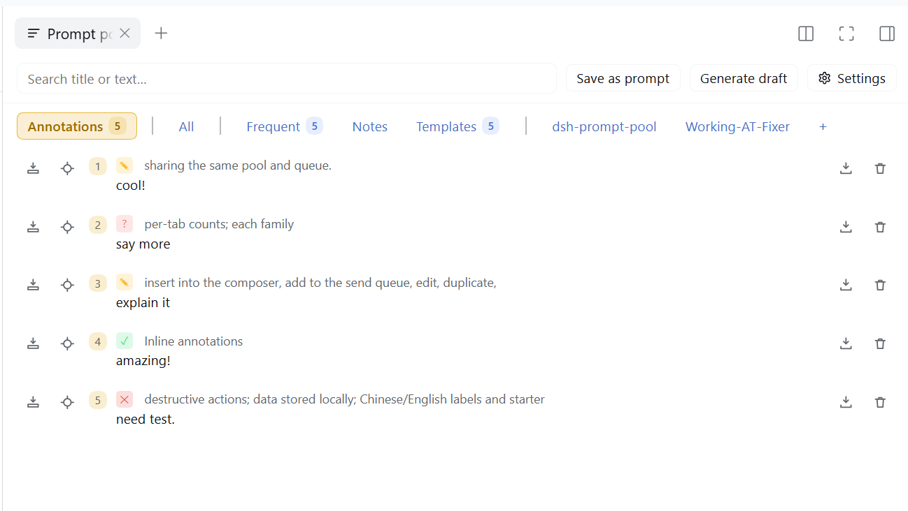
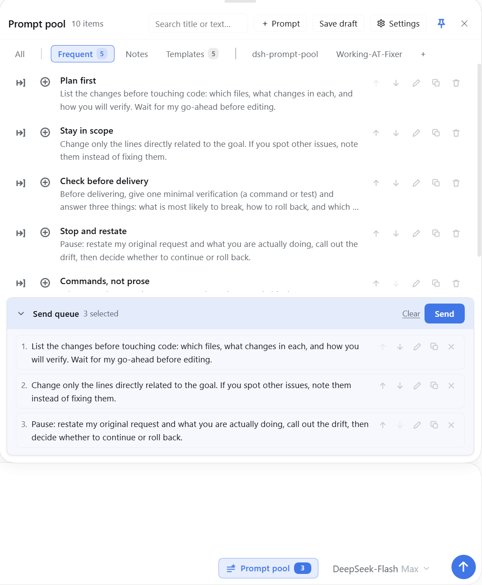
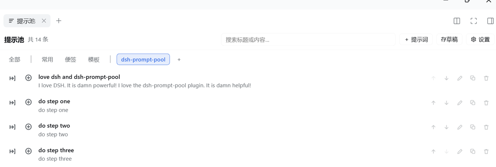
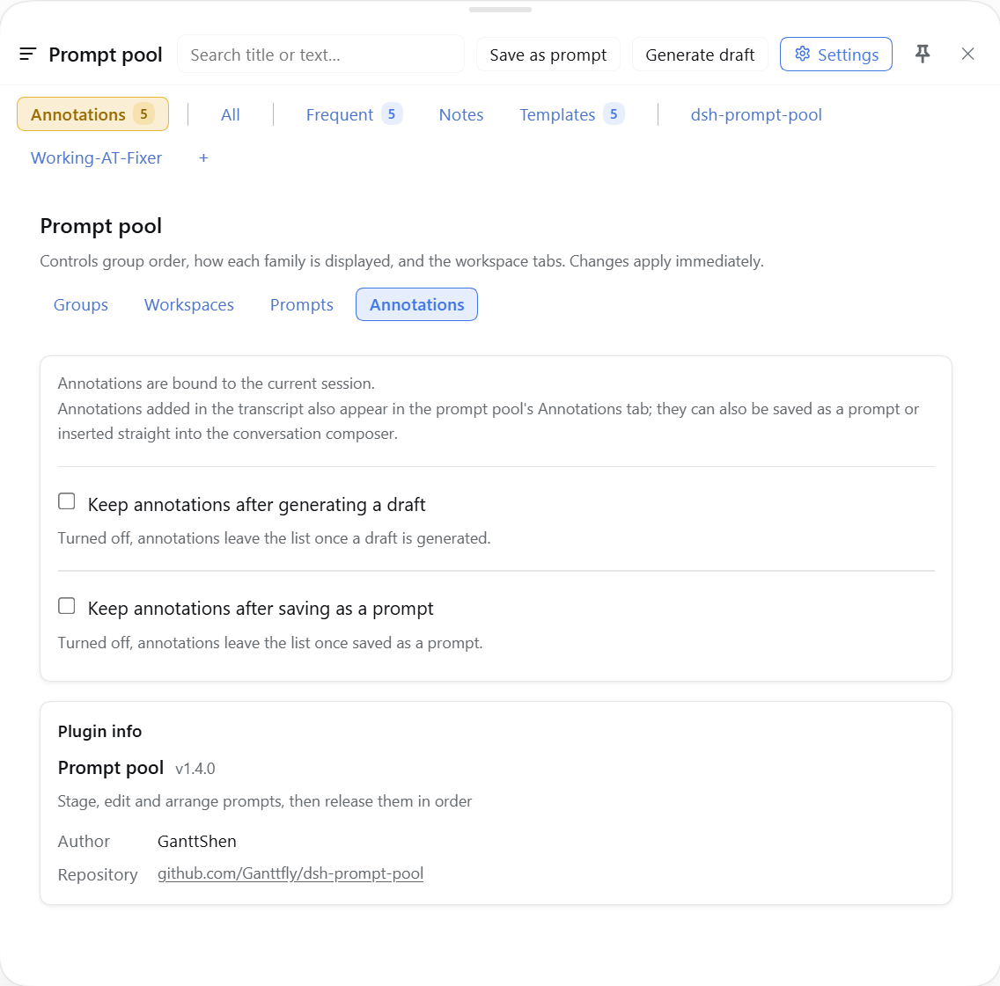

# Prompt pool · 提示池

[](https://www.npmjs.com/package/dsh-prompt-pool) [](https://dshfind.com/en/plugins/Ganttfly/dsh-prompt-pool?ref=badge)

English | [中文](README.zh.md)

A staging pool for prompts inside DeepSeek Harness. Park a half-written prompt without sending it,
arrange a playlist of prompt items, and release the whole batch into the composer's send queue in order.

It sits in two places: a trigger beside the composer, and a page in the right sidebar.

## Screenshots



**Annotate while you read.** Select a passage and add a note right where it belongs, without leaving the
reply; the original wording stays attached, so the context is easy to follow and no key point slips away.
The **Annotations** tab on the right collects the whole set — locate a passage, insert one note, save it
as a prompt, or turn every note into one quoted draft.



The composer panel: group tabs with their counts, the row actions (insert, queue, edit, duplicate,
delete), and the send queue at the bottom. The trigger beside the composer carries the queued count.



The same pool as a right-sidebar page — a native tab on DSH 0.2+, with the group tabs and one tab per
workspace.



Settings: annotations are bound to the current session; choose whether they stay after generating a
draft or saving as a prompt, plus the plugin info card.

## Features

- **Staging instead of sending** — save a draft into the pool; nothing runs until you release it.
- **Localized starter prompts** — a new pool is seeded in the host language, and Settings → Prompts
  can reset the built-in set in the current interface language. Edited built-ins can be kept as
  ordinary items; custom items and the queue are left alone.
- **Ordered release** — queue items in the order you want, then send them one by one; each submission
  waits for the composer to be accepted before the next starts. On hosts that expose the conversation
  queue, items go straight into the queue without touching the composer; otherwise the composer path
  is used. While a release runs, both views show progress and a Stop control; the queue is locked
  until it finishes.
- **Right-click to save** — select text in a reply or in one of your own messages, then right-click: the
  menu offers **Copy** and **Add to the prompt pool**, whose submenu lists the groups currently on show;
  picking one stores the selection as a new item there. The group used last time leads the submenu;
  Shift+F10 opens the same menu, and a right-click without a selection keeps the browser menu.
- **Annotate while you read** — select a passage in an assistant reply and right-click **Annotate**:
  pick a kind (note / question / agree / disagree / idea / to-do), type up to ten characters (or leave it
  empty for a glyph-only badge), and the badge lands right after the passage with a matching underline.
  The note stays on the exact wording, so you can keep reading and come back to the context instead of
  losing the point in a separate scratchpad; click the badge to edit. The **Annotations** tab always
  exists: **Locate** scrolls to the passage, **Insert** writes one note into the composer, **Save as
  prompt** files one note into a pool group (the chooser leads with the session's workspace, then 常用),
  and **Generate draft** composes one numbered message that quotes each passage with its kind. The tab
  header can save every note as one prompt or generate that draft as well. Saved notes keep a green
  marker; notes are stored per session and survive reloads.
- **Composer panel** — search, group tabs, per-row insert / queue / edit / duplicate / delete, and the
  send-queue card with collapse, clear and send. Drag its top edge to change the height, or its left
  edge to change the width; pin it to keep it open over the conversation.
- **Sidebar page** — the same pool as a full-height page in the right sidebar.
- **Groups** — frequent / notes / templates built in, plus your own categories and one tab per workspace.
  Each family can be expanded, folded into a single tab, or hidden.
- **Settings** — group order and display, visible workspaces, two switches for post-use retention, a
  reset for the built-in prompt set, and an **Annotations** tab (session binding explained, plus
  keep-after-draft and keep-after-save switches).
- **Guarded destructive actions** — deleting an item, clearing the queue and removing a queued entry all
  ask first; deletes and clears can be undone from the toast.
- **Chinese and English** — every label follows the harness language, including the sidebar tab name.

## Install

The package is on npm as [`dsh-prompt-pool`](https://www.npmjs.com/package/dsh-prompt-pool). Once the
community market has indexed it, install it from the plugin market in Settings, or from the CLI:

```powershell
dsh plugin add dsh-prompt-pool --profile <profile>
```

A tarball works the same way:

```powershell
dsh plugin add ./dsh-prompt-pool-<version>.tgz --profile <profile>
```

Then enable the bundle in **Settings → Plugins**. The plugin is a bundle; installing the package alone
does not turn it on.

## Usage

1. Click **提示池 / Prompt pool** beside the composer (or open the sidebar page).
2. **Save draft** copies the composer content — text and image attachments — into the pool. A small popup
   offers the groups currently shown in the tab bar — built-in, custom, and every displayed
   workspace — and the toast names the destination. The composer keeps its text.
3. Select text in a conversation and right-click: the menu offers **Copy** and **Add to the prompt
   pool**; open the submenu and picking a group turns the selection into a new item there.
4. To comment on specific passages instead, right-click **Annotate**: pick a kind, type up to ten
   characters, and the badge appears right after the passage. The pool's **Annotations** tab collects
   every note in the session; **Locate** scrolls to a passage, **Insert** writes one note into the
   composer, **Save as prompt** files one note into a group, and **Generate draft** turns the whole list
   into one numbered message. The tab header can also save every note as one prompt.
5. Add rows to the queue with the ⊕ control, reorder them in the queue card, then press **发送**.
6. Each queued item is written into the composer and submitted in turn.

## Compatibility

- DSH **>= 0.2.0-rc.1**; verified on **0.2.2-rc.1**.
- The right-click menu needs the conversation text-interaction service, present on 0.2.2-rc.1. A host
  without it keeps the native menu; the panel, the page and capture are unaffected.
- The sidebar page uses the native right-sidebar tab registry when the host provides it (DSH 0.2+).
  On hosts without it the plugin falls back to [`dsh-better-sidebar`](https://github.com/omdsh-dev/DSH-better-sidebar).
  With neither, the composer panel and the settings page still work.

## Data

- Items and settings: `localStorage["dsh.prompt-pool.v1"]`.
- Annotations: `localStorage["dsh.prompt-pool.notes.v1"]`.
- Pool images: IndexedDB `dsh-prompt-pool-images.v1`.
- Before a schema upgrade, the previous payload is copied once to
  `localStorage["dsh.prompt-pool.v1.backup"]`.
- If a write fails (storage full or blocked), both views say the change was not saved.
- Image bytes that nothing references are deleted on startup; an image removed and saved is deleted
  immediately.

Uninstalling the plugin does not delete these stores, so reinstalling later brings the pool back.
Clearing them removes the pool for good.

## Known limitations

- **Non-image attachments are not captured.** The composer's browser files are reachable, but the pool
  only stores images; a capture reports how many attachments were left behind.
- **Reference chips come back as text.** A saved item that referenced a file or a session keeps the
  reference text (so the model still sees it), but inserting it back writes plain text rather than a
  clickable chip — the host exposes no API to rebuild one.
- **The right-click menu covers conversation text only.** Replies, your own messages and expanded
  reasoning are selectable sources; tool cards, the sidebar and the composer keep their own menus.
- **Right-clicking a selection replaces the browser's own menu.** The menu carries Copy itself, but the
  browser's Search / Translate / Inspect rows are not available from it.
- **Annotation cards follow the rendered text.** A note on a folded or unmounted reply keeps its row in
  the pool's Annotations tab, but has no card, pin or highlight until that text is rendered again; the
  composed reply still uses it.
- **A card can cover the lines below its passage.** It hangs right after the end of the passage, so a
  note on a short line may overlap the following lines to its right; the Annotations tab always keeps
  the full list.
- **A capture does not clear the composer.** It copies; use the editor's own clear to remove the text.

## Development

```powershell
npm run check                       # lint + the whole suite, as CI runs it
npm run lint                        # syntax, version pin, locale parity and dead keys
npm test                            # the whole suite through tools/run-tests.js
node tools/smoke.js                 # module loads, slots register, locale retitle, version pin
node tools/render-smoke.js          # every slot renders; panel and settings structure checks
Get-ChildItem tools/verify/*.js | ForEach-Object { node $_.FullName }   # behavioural checks
```

GitHub Actions runs the same `npm test` on every push and pull request.

The panel's box model is measured in a real browser instead of by eye. It needs playwright on
`NODE_PATH` and a `react`/`react-dom` copy to serve — install those once into `%TEMP%\pp-harness`, or
point `PP_VENDOR` at a `node_modules` that has them:

```powershell
pnpm --dir "$env:TEMP\pp-harness" add react@18 react-dom@18
$env:NODE_PATH = "$env:DSH_PROFILE_DIR\node_modules"
node tools/panel-geometry/run.js --viewport 1280x760 --composer 0.34 --drag --shot panel-height
node tools/panel-geometry/run.js --viewport 1280x900 --composer 0.9 --tray 6 --shot queue-card
```

`--composer` puts the composer partway up the window (a new session). The mock keeps a top bar above a
clipping conversation pane, so the run fails when the panel's header ends up clipped or scrolled out of
its own box. `--tray N` seeds the send queue, and the run then fails when a short queue already scrolls.

The package lives in `plugin/`; `tools/` is development-only, and `_shots/` is a local screenshot
scratch folder that stays out of the repository.

## License

MIT
