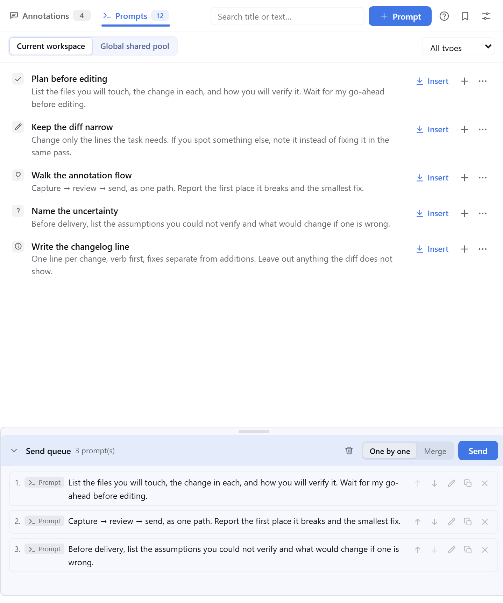
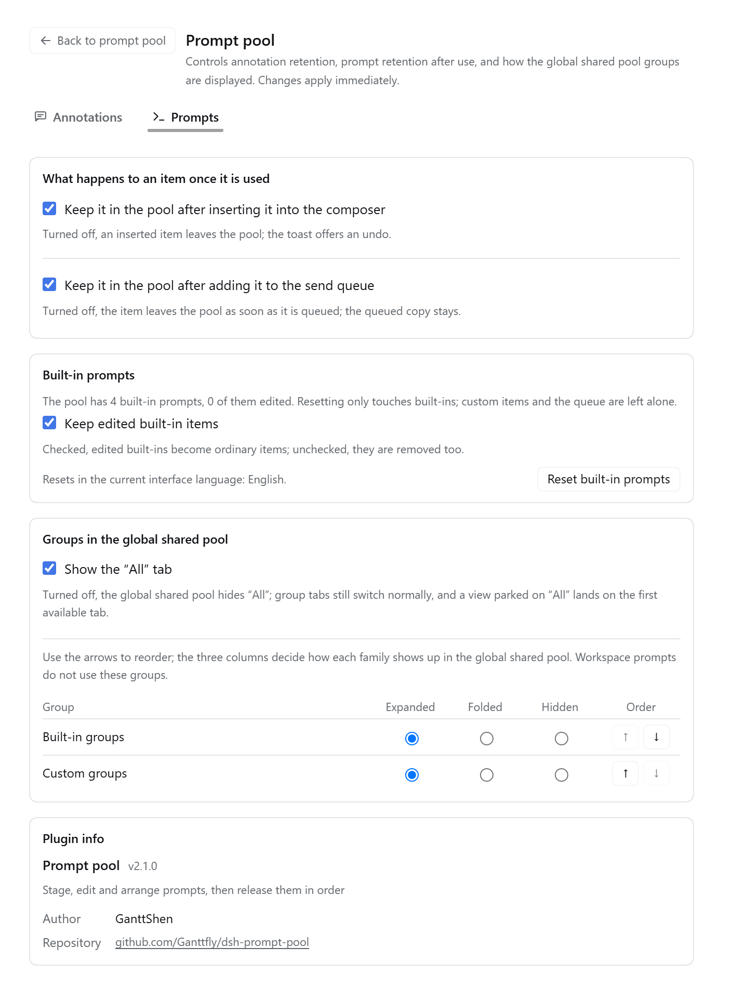

# Prompt pool · 提示池

[](https://www.npmjs.com/package/dsh-prompt-pool) [](https://dshfind.com/en/plugins/Ganttfly/dsh-prompt-pool?ref=badge)

English | [中文](README.zh.md)

A prompt staging pool for DeepSeek Harness. Keep a half-written prompt out of the agent's way until it is
ready, line up the prompts you want to run next, and annotate a long reply without losing the sentence you
mean.

It sits in two places: a trigger beside the composer, and a page in the right sidebar.

## Screenshots


**Annotate while you read.** Select a passage and add a note right where it belongs, without leaving the
reply; the original wording stays attached, so the context is easy to follow and no key point slips away.
The **Current session** tab on the right collects the notes for that session — locate a passage, insert one
note, save it as a prompt, or turn every note into one quoted draft. Annotations stay with their own
session and never leak into another conversation.


The composer panel has two scopes: **Annotations** for the current session and **Prompts** for the current
workspace. Prompt rows keep the same insert / queue / edit / duplicate / delete actions and the shared send
queue sits at the bottom. Switching scopes never replaces the row styles.



The sidebar is the full workbench — **Current session / Current workspace / Global shared pool** on
DSH 0.2+. Workspace prompts are filtered by type; the global shared pool keeps its built-in and custom group
tabs. Saving a note as a prompt opens a confirmation step where the title, body, images, type and target
group can be edited, with a reminder that the conversation context is not carried over.



Settings: annotations are bound to the current session; choose whether they stay after generating a
draft or saving as a prompt, plus the plugin info card.

## Why a prompt pool?

Working with an agent is rarely one prompt. The friction sits between messages:

| Where it hurts | What the pool does |
|---|---|
| You are still shaping the prompt, but the send button is one keystroke away. | Park the draft in a group; nothing runs until you release it. |
| The next prompts are already in your head, and retyping them breaks the sequence. | Queue them in order and release one by one, with progress and Stop. |
| A long answer needs a precise reply on one sentence, not a vague “looks good”. | Annotate the passage inline; the note stays on the exact words, and **Review** sends the checked notes to the session queue as one quoted prompt. |
| The constraint lives in an earlier message or another workspace. | Right-click capture saves to the current workspace or the global shared pool, so project-specific prompts stay with the project. |

The goal is not another notes app. It is to keep the context, the exact wording and the next action next to
the conversation, so the agent gets a precise instruction and you do not lose the thread.

## Features

- **Staging instead of sending** — save a draft into the pool; nothing runs until you release it.
- **Ordered release** — queue items in the order you want, then send them one by one; each submission
  waits for the composer to be accepted before the next starts. On hosts that expose the conversation
  queue, items go straight into the queue without touching the composer; otherwise the composer path
  is used. While a release runs, both views show progress and a Stop control; the queue is locked
  until it finishes. With more than one entry the queue can also **Merge & send**, numbering the entries
  into one prompt before handing it to the session queue.
- **One-click handoff** — a strip above the composer sits beside the host's own queued messages and
  shows both counts; **Push** hands the pool's send queue to the host queue in order, without the
  release progress overlay and without touching the composer. Pushed entries leave the send queue, and
  a host that exposes no queue admission keeps them and says so.
- **Annotate while you read** — select a passage in an assistant reply and right-click **Annotate**:
  pick a kind from its submenu (note / question / agree / disagree / idea / additional info / to-do), type up to 100
  full-width or 200 half-width characters (or leave it empty for a glyph-only badge), and the badge lands
  right after the passage with a matching underline. Picking a kind preselects it in the bubble; without
  a pick new notes start as **Agree**. Add images from the bubble or paste them into its body, and the
  thumbnails stay with the annotation. The badge follows the conversation's text size, so it grows with
  the reading font instead of staying small.
  The note stays on the exact wording, so you can keep reading and come back to the context instead of
  losing the point in a separate scratchpad; click the badge to edit. The **Current session** tab always
  exists: each row leads with a checkbox (all checked by default); **Locate** scrolls to the passage,
  **Insert** writes one note into the composer, and **Save as prompt** opens a confirmation step for the
  title, body, images, type and target group before filing the prompt. The header's **Review** opens a
  review card in the bottom dock (like the send queue): adjust the checked notes, then choose
  **Preview prompt** to inspect the generated prompt and send it, add it to the outbox, save it as a
  prompt, or go back to adjust. The prompt is grouped
  by kind with a type-specific response contract; additional info is used to revisit the related conclusions
  rather than to execute anything. Opinions, ideas and agreements can be marked
  **Implement if adopted / feasible / approved** to authorize the same-turn execution; the flag is off by
  default and is only acted on when no further discussion is needed. To-dos choose between **Execute now**
  and **Save as prompt** (the safe default). Questions, disagreements and additional info have no immediate
  option. To-dos set to Save as prompt are not sent and are saved to the current workspace's prompt pool
  instead. After a successful send, the sent annotations leave the annotation list; the parked to-dos are
  in the prompt pool, and the batch log keeps the audit record. There are no open/handled status filters to
  maintain. Saved notes keep a green marker; notes are stored per session, survive reloads, and are not
  shown in another session.
- **Prompt types** — each prompt has at most one fixed type: decision / question / opinion / idea /
  supplement / to-do / inspiration, or unclassified. Saving a note seeds it from the annotation kind
  (agree and disagree both map to decision); the type can be changed in the save step or the editor and
  filtered from the list header. Templates, habits and notes are groups, not types. The global shared pool
  offers a **Capture inspiration** shortcut that creates a global note with the inspiration type preselected.
- **Composer panel** — search, the current workspace's prompt list, type filtering, per-row insert / queue /
  edit / duplicate / delete, and the shared send-queue card with collapse, clear and send. Its two scopes
  are **Annotations** (current session) and **Prompts** (current workspace); the panel never shows the
  global shared pool. Drag its top edge to change the height, or its left edge to change the width; pin it
  to keep it open over the conversation.
- **Sidebar page** — the full workbench over the same data: **Current session / Current workspace / Global
  shared pool**, defaulting to the current session. Workspace prompts use the type filter; the global
  shared pool keeps the existing group tabs for the built-in and custom groups.
- **Save step** — saving a note as a prompt no longer writes immediately. It opens a confirmation with the
  title, body, images, type and destination group, plus a reminder that the conversation context is not
  carried over. The source session, node and quote are not stored on the prompt.
- **Right-click to save** — select text in a reply or in one of your own messages, then right-click: the
  menu offers **Copy** and **Add to the prompt pool**, whose submenu lists the groups currently on show;
  picking one stores the selection as a new item there. The group used last time leads the submenu;
  Shift+F10 opens the same menu, and a right-click without a selection keeps the browser menu.
- **Groups** — the global shared pool keeps frequent / notes / templates built in, plus your own categories;
  each workspace has its own prompt pool instead of a global workspace group. Each family can be expanded,
  folded into a single tab, or hidden; the **All** tab can be hidden too.
- **Localized starter prompts** — a new pool is seeded in the host language, and Settings → Prompts
  can reset the built-in set in the current interface language. Edited built-ins can be kept as
  ordinary items; custom items and the queue are left alone.
- **Settings** — annotation retention, the two post-use retention switches, the built-in prompt reset,
  and the global shared pool's group order/display (including whether the **All** tab shows). The page has
  three tabs — **Annotations / Prompts / Global shared pool** — and opens on Annotations. Workspaces no
  longer have their own settings page; save and capture destinations are the current workspace plus the
  global shared pool.
- **Guarded destructive actions** — deleting an item, clearing the queue and removing a queued entry all
  ask first; deletes and clears can be undone from the toast.
- **Chinese and English** — every label follows the harness language, including the sidebar tab name.

## Install

The package is on npm as [`dsh-prompt-pool`](https://www.npmjs.com/package/dsh-prompt-pool). Once the
community market has indexed it, install it from the plugin market in Settings, or from the CLI:

```powershell
dsh plugin add dsh-prompt-pool --profile <profile>
```

A tarball works the same way:

```powershell
dsh plugin add ./dsh-prompt-pool-<version>.tgz --profile <profile>
```

Then enable the bundle in **Settings → Plugins**. The plugin is a bundle; installing the package alone
does not turn it on.

## Usage

1. Click **提示池 / Prompt pool** beside the composer (or open the sidebar page).
2. **Save draft** copies the composer content — text and image attachments — into the pool. A small popup
   offers the groups currently shown in the tab bar — built-in, custom, and every displayed
   workspace — and the toast names the destination. The composer keeps its text.
3. Select text in a conversation and right-click: the menu offers **Copy** and **Add to the prompt
   pool**; open the submenu and picking a group turns the selection into a new item there.
4. To comment on specific passages instead, right-click **Annotate**: pick a kind, type up to 100
   full-width or 200 half-width characters, and the badge appears right after the passage. The pool's
   **Annotations** tab collects every note in the session; **Locate** scrolls to a passage, **Insert**
   writes one note into the composer, and **Save as prompt** files one note into a group. **Review**
   opens the batch sheet; optionally mark items to execute, send the checked notes to the session queue,
   and those notes leave the list. To-dos set to Save as prompt are saved to the prompt pool instead.
5. Add rows to the queue with the ⊕ control, reorder them in the queue card, then press **发送**.
6. Each queued item is written into the composer and submitted in turn.

## Compatibility

- DSH **>= 0.2.0-rc.1**; verified on **0.2.2-rc.1**.
- The right-click menu needs the conversation text-interaction service, present on 0.2.2-rc.1. A host
  without it keeps the native menu; the panel, the page and capture are unaffected.
- The sidebar page uses the native right-sidebar tab registry when the host provides it (DSH 0.2+).
  On hosts without it the plugin falls back to [`dsh-better-sidebar`](https://github.com/omdsh-dev/DSH-better-sidebar).
  With neither, the composer panel and the settings page still work.

## Data

- Items and settings: `localStorage["dsh.prompt-pool.v1"]`.
- Annotations: `localStorage["dsh.prompt-pool.notes.v1"]`.
- Pool images: IndexedDB `dsh-prompt-pool-images.v1`.
- Before a schema upgrade, the previous payload is copied once to
  `localStorage["dsh.prompt-pool.v1.backup"]`.
- If a write fails (storage full or blocked), both views say the change was not saved.
- Image bytes that nothing references are deleted on startup; an image removed and saved is deleted
  immediately.

Uninstalling the plugin does not delete these stores, so reinstalling later brings the pool back.
Clearing them removes the pool for good.

## Known limitations

- **Non-image attachments are not captured.** The composer's browser files are reachable, but the pool
  only stores images; a capture reports how many attachments were left behind.
- **Reference chips come back as text.** A saved item that referenced a file or a session keeps the
  reference text (so the model still sees it), but inserting it back writes plain text rather than a
  clickable chip — the host exposes no API to rebuild one.
- **The right-click menu covers conversation text only.** Replies, your own messages and expanded
  reasoning are selectable sources; tool cards, the sidebar and the composer keep their own menus.
- **Right-clicking a selection replaces the browser's own menu.** The menu carries Copy itself, but the
  browser's Search / Translate / Inspect rows are not available from it.
- **Annotation cards follow the rendered text.** A note on a folded or unmounted reply keeps its row in
  the pool's Annotations tab, but has no card, pin or highlight until that text is rendered again; the
  composed reply still uses it.
- **A card can cover the lines below its passage.** It hangs right after the end of the passage, so a
  note on a short line may overlap the following lines to its right; the Annotations tab always keeps
  the full list.
- **A capture does not clear the composer.** It copies; use the editor's own clear to remove the text.

## Development

```powershell
npm run check                       # lint + the whole suite, as CI runs it
npm run lint                        # syntax, version pin, locale parity and dead keys
npm test                            # the whole suite through tools/run-tests.js
node tools/smoke.js                 # module loads, slots register, locale retitle, version pin
node tools/render-smoke.js          # every slot renders; panel and settings structure checks
Get-ChildItem tools/verify/*.js | ForEach-Object { node $_.FullName }   # behavioural checks
```

GitHub Actions runs the same `npm test` on every push and pull request.

The panel's box model is measured in a real browser instead of by eye. It needs playwright on
`NODE_PATH` and a `react`/`react-dom` copy to serve — install those once into `%TEMP%\pp-harness`, or
point `PP_VENDOR` at a `node_modules` that has them:

```powershell
pnpm --dir "$env:TEMP\pp-harness" add react@18 react-dom@18
$env:NODE_PATH = "$env:DSH_PROFILE_DIR\node_modules"
node tools/panel-geometry/run.js --viewport 1280x760 --composer 0.34 --drag --shot panel-height
node tools/panel-geometry/run.js --viewport 1280x900 --composer 0.9 --tray 6 --shot queue-card
```

`--composer` puts the composer partway up the window (a new session). The mock keeps a top bar above a
clipping conversation pane, so the run fails when the panel's header ends up clipped or scrolled out of
its own box. `--tray N` seeds the send queue, and the run then fails when a short queue already scrolls.

The package lives in `plugin/`; `tools/` is development-only, and `_shots/` is a local screenshot
scratch folder that stays out of the repository.

## License

MIT
