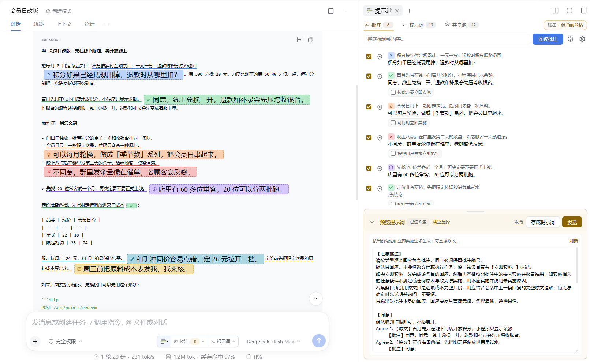
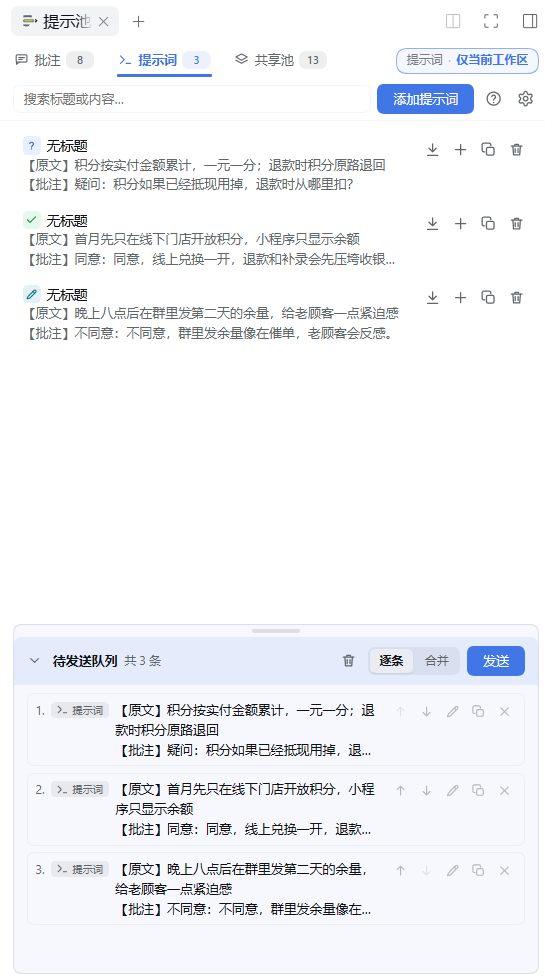
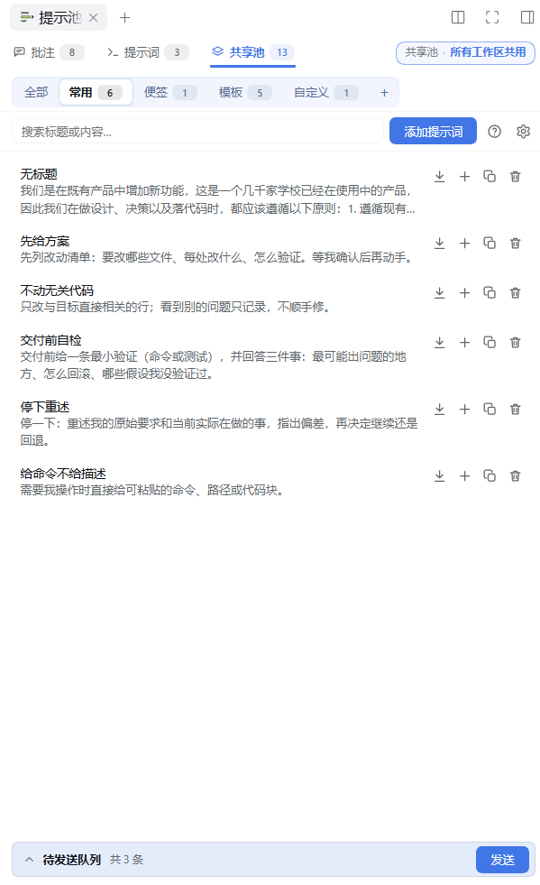

# Prompt pool · 提示池

[](https://www.npmjs.com/package/dsh-prompt-pool) [](https://dshfind.com/en/plugins/Ganttfly/dsh-prompt-pool?ref=badge)

English | [中文](README.zh.md)

A prompt staging pool for DeepSeek Harness. Keep a half-written prompt out of the agent's way until it is
ready, line up the prompts you want to run next, and annotate a long reply without losing the sentence you
mean.

It sits in two places: a split trigger beside the composer, and a page in the right sidebar with three
destinations — **Annotations**, **Prompts** and **Shared**.

## Screenshots



**Read, mark it, then send one instruction.** Right-click a selection and pick **Select to annotate** to pin
a note to those exact words, or pick **Continuous** and click assistant blocks one after another: an amber
outline and a `Paragraph · 42 chars` label mark the block before the note lands, and the pick keeps running,
so the next block is one click away. The **Annotations** page lists the session's notes in transcript order —
locate a passage, insert one note, edit a note in place, file it as a prompt. Select notes and choose
**Summarize in one click** to open the **Prompt preview** card: checked rows, immediate execution and to-do
routing, an editable prompt built from every annotation, and **Cancel** / **Save as prompt** / **Send** in
its status bar.



**Prompts belong to the current workspace, and the queue is where they line up.** Each row leads with its
optional type badge — Decision, Question, Opinion, Idea, Supplement, To-do or Inspiration — and carries
insert, queue, duplicate and delete; clicking the title opens the editor. The **send queue** holds prompts
only, starts as a one-line strip, and its header switches between **one by one** and **merge**. A queued row
wears the mark of what it is — a prompt's own type, the review glyph for a summarized batch, an annotation's
kind — instead of repeating the word.



**Shared** is the cross-workspace pool: frequent / notes / templates built in, plus your own groups. A family
can be expanded, folded into a single tab, or hidden; folded, its groups stay as chips with their counts, and
the family tab itself means the whole family. A list that mixes groups ends each row with its group name.
The header row above spells out the scope of the destination in view — **Prompts · This workspace only**,
**Annotations · This session only**, **Shared · Shared across workspaces** — in the amber or blue of the tab
it describes.

## Why a prompt pool?

Working with an agent is rarely one prompt. The friction sits between messages:

| Where it hurts | What the pool does |
|---|---|
| You are still shaping the prompt, but the send button is one keystroke away. | Park the draft in a group; nothing runs until you release it. |
| The next prompts are already in your head, and retyping them breaks the sequence. | Queue them in order and release one by one, with progress and Stop. |
| A long answer needs a precise reply on one sentence, not a vague “looks good”. | Annotate the passage inline; the note stays on the exact words and can be reviewed alone or merged into one quoted instruction. |
| The constraint lives in an earlier message or another workspace. | Right-click capture saves to the current workspace or the shared pool, so project-specific prompts stay with the project. |

The goal is not another notes app. It is to keep the context, the exact wording and the next action next to
the conversation, so the agent gets a precise instruction and you do not lose the thread.

## Features

- **Staging instead of sending** — a draft parked in the pool stays inert; nothing reaches the agent until
  you release it. **Save draft** lives in the composer's **Prompts** menu: it copies the composer's text and
  images into the current workspace or a shared group (a small picker offers both) and leaves the composer
  text in place. The page header carries no copy action of its own, so the command sits beside the text it
  copies.
- **The send queue** — prompts only, and only where prompts live: the **Prompts** and **Shared**
  destinations and the panel's **Prompts** mode. **+** on a row adds it; the header switches between
  **one by one** and **merge**, and rows can be moved up or down, edited, duplicated or removed. Sending
  one by one writes each prompt to the host's session queue and waits for the previous one to be accepted;
  on a host without that queue it types into the composer instead. **Merge** previews every queued prompt
  in order, with its images as thumbnails, and sends them as one message. A release shows progress and a
  **Stop** control, and the queue is locked until it finishes. Empty, the card collapses to a dashed
  one-line strip — **Empty — use the ＋ control on a prompt row** — so the bottom of the list never shifts
  under the pointer.
- **Annotate while you read** — select a passage in an assistant reply and right-click **Select to
  annotate**, then pick a kind from the submenu: note, question, agree, disagree, idea, additional info or
  to-do. Write up to 500 full-width or 1,000 half-width characters, or leave the body empty for a
  glyph-only badge. The badge lands right after the passage with a matching underline, and each kind keeps
  its own vivid color across the badge, the inline chip and the underline. Click the badge — or the
  annotated words themselves — to reopen its bubble. Images can be added from the bubble or pasted in.
- **Point at a block** — **Continuous** in the page header, or the first row of the composer's
  **Annotations** menu, starts a block picker. Only assistant replies are eligible: a paragraph, list item,
  heading, quote, code block or table cell draws an amber outline and a size label under the pointer, and a
  click adds a note and opens its editor bubble beside the block. The pick never ends, the right sidebar
  keeps its state, and the annotation list is not pulled into edit mode. Saving commits even an empty body;
  closing an untouched bubble discards the pick instead of leaving an empty badge. Clicking a block that
  already has a note opens that note. The bottom bar only reports `N added` and offers **Done**; Esc or a
  click outside the conversation leaves the mode. Your own messages, image-only and empty blocks are
  refused, and the picker stays inside the conversation, so the composer and turn rail still work.
- **Consecutive notes keep their kind** — a kind picked in a bubble becomes the default for the next pick,
  and the picker starts on the kind last used on that page (initially **Note**). A right-click annotation
  with no pick made starts as **Agree**.
- **The Annotations page** — the session's notes in transcript order. **Locate the passage** wears a map pin
  and scrolls the transcript back to the words; **Insert into the composer** writes one note in one fixed
  block — 【Original】the words, then 【Annotation】<kind>: what you wrote; the **Save as prompt** icon hands
  the note to the pool's editor. Click a note's body to change its kind and text in place, while the quoted
  passage stays read-only. A newly added note scrolls into view and wears an amber **Just added** marker for
  a few seconds; saved notes keep a green marker. Notes belong to their session, survive reloads, and never
  appear in another conversation.
- **Prompt preview** — **Summarize in one click** in the bottom bar opens the review card, which sits at the
  bottom like the send queue, collapses to a strip and can be resized by dragging its top edge (double-click
  to reset). Rows gain checkboxes, immediate execution and to-do routing; **Locate the passage** stays, while
  insert / save / delete hide. The card is the prompt composer: it builds one numbered block per checked
  annotation (its ID kept as `Agree-1`, `Question-2`, …), previews and edits the result, and **Refresh**
  rebuilds it. The prompt opens with the response contract, one instruction per line: answer every
  annotation by kind and keep its ID; respond only, never touch files or tasks, unless the item carries an
  【Execute now…】 marker; when executing, finish that item's answer first, then do exactly what was asked
  and report; ask instead of guessing when a quote is only an option or an incomplete fragment. The header
  splits by purpose — chips and **Select all** / **Clear** on the left, shown only when they can act;
  **Cancel**, **Save as prompt** and **Send** on the right. Cancel leaves summary mode, collapses the card
  and changes nothing else. Annotations never enter the send queue, and no single note has a send button.
- **Filing a note as a prompt** — with a sidebar page present, the pool switches to **Prompts** and opens its
  own editor with the draft written: a two-line 【原文】 / 【批注】 body, a blank title, the type that answers
  the note's kind (an agreement files as a decision, a disagreement or a comment as an opinion, the rest by
  name) and the note's images carried over. A reviewed batch arrives the same way — untitled, one numbered
  block per note, typed only when every checked note shares one kind. The standalone save sheet remains the
  fallback: composer-panel hosts, a session without a workspace, or a draft the page is already holding.
  Source session, node and quote are never stored on the prompt.
- **Composer panel** — a brand row with the pool mark, its name, pin and close; search, the current
  workspace's prompts, per-row **Insert**, **+**, duplicate and delete, and the shared send queue. It opens
  in **Annotations** mode; **Prompts** mode is where prompts and the queue live. Both editors share one card
  — title row, kind chips, body, meta row, action row — so a note and a prompt keep the same rhythm; the
  add-image plus sits inside the body field, the body is measured in display cells with a live count, and
  `@` references files. Switching items with unsaved edits asks whether to keep editing, discard or save and
  switch. Drag the top edge for height, the left edge for width; pinning keeps it open over the
  conversation. Help and **Settings** sit beside search.
- **Sidebar page** — the full workbench over the same data, with **Annotations**, **Prompts** (current
  workspace only) and **Shared** (built in and custom groups) as destinations, opening on annotations.
  Shared group tabs sit on a row of their own between the destinations and the search field, and the page
  uses the full width of its host.
- **Composer trigger** — a split bar. The brand cap opens the sidebar page and leaves its destination alone;
  the **Annotations** menu offers **Continuous**, **Summarize in one click** (with the session's count) and
  the annotations view; the **Prompts** menu offers **Save draft**, **Add prompt** and the prompts view. Each
  tray row wears its own mark — a pointer, a funnel, the annotation bubble, a tray, a boxed plus, the prompt
  chevron — and the two menus draw in their own accent. On hosts without a right sidebar the cap and both
  menus open the panel instead.
- **Right-click to save** — select text in a reply or in one of your own messages, then right-click: the menu
  offers **Copy** and **Add to the prompt pool**, whose submenu lists the groups on show. Picking one stores
  the selection there; the group used last time leads the submenu. Shift+F10 opens the same menu, and a
  right-click without a selection keeps the browser's own.
- **Groups** — the shared pool keeps frequent / notes / templates built in, plus your own categories; each
  workspace has its own prompt pool instead of a global workspace group. A family can be expanded, folded
  into a single tab, or hidden, and each family states its three choices on its own row. Folded, its groups
  appear as chips with their counts on a quieter track underneath; a chip narrows the list to that group and
  new items land in it, and clicking the active chip again — or the family tab — widens the list back. A
  family with one group shows no chips. The **All** tab can be hidden too.
- **Localized starter prompts** — a new pool is seeded in the host language, and Settings → Prompts can
  reset the built-in set in the current interface language: edited built-ins are kept as ordinary items when
  the box is ticked, custom items and the queue are left alone, and the button's hover text names the
  language it will reset into.
- **Settings** — one destination page with two sections, opening on **Annotations**. **Annotations** holds
  the three retention switches — keep a note after it is inserted into the composer (on by default), after a
  summary sends it away (off by default), and after it is filed as a prompt; when a switch is off the marks
  leave the list and the toast offers **Undo**. **Prompts** holds the post-insert and post-queue retention,
  the built-in reset, and the shared pool's group order and display. The plugin card carries only the
  credits — author and repository — with the version beside its heading. Workspaces no longer have their own
  settings page: save and capture destinations are the current workspace plus the shared pool.
- **Guarded destructive actions** — deleting an item, clearing the queue and removing a queued entry all ask
  first; deletes and clears can be undone from the toast.
- **Chinese and English** — every label follows the harness language, including the sidebar tab name, and
  the two languages differ only in wording, never in layout.

## Install

The package is on npm as [`dsh-prompt-pool`](https://www.npmjs.com/package/dsh-prompt-pool). Once the
community market has indexed it, install it from the plugin market in Settings, or from the CLI:

```powershell
dsh plugin add dsh-prompt-pool --profile <profile>
```

A tarball works the same way:

```powershell
dsh plugin add ./dsh-prompt-pool-<version>.tgz --profile <profile>
```

Then enable the bundle in **Settings → Plugins**. The plugin is a bundle; installing the package alone
does not turn it on.

## Usage

1. Click the **Prompt pool** trigger beside the composer, or open the sidebar page.
2. Open the trigger's **Prompts** menu and pick **Save draft**: a small popup offers the current workspace
   and the shared-pool groups, and the toast names the destination. The composer keeps its text.
3. To keep a passage instead, select it in a conversation and right-click **Add to the prompt pool**, then
   pick a group.
4. To comment on what you read, right-click a selection and choose **Select to annotate** — or start
   **Continuous** from the page header and click block after block. Pick a kind, write your note, save. The
   **Annotations** page collects them: **Locate the passage** scrolls back to the words, **Insert** writes
   one note into the composer, the **Save as prompt** icon opens it as a draft, and clicking a body edits it
   in place. Select notes and choose **Summarize in one click**; check, route and execute what applies in
   the card, edit the prompt if needed, then **Save as prompt** or **Send**. **Cancel** backs out with
   nothing changed.
5. Press **+** on a prompt row to queue it; click the collapsed queue strip to open it, reorder with the
   arrows, then **Send** one by one or switch to **Merge** for a preview.
6. One by one submits each prompt in turn; merge sends them as a single message. Both can be stopped while
   they run, and everything not yet sent stays in the queue.

## Compatibility

- DSH **>= 0.2.0-rc.1**; verified on **0.2.2-rc.1**.
- The right-click menu needs the conversation text-interaction service, present on 0.2.2-rc.1. A host
  without it keeps the native menu; the panel, the page and capture are unaffected.
- The sidebar page uses the native right-sidebar tab registry when the host provides it (DSH 0.2+).
  On hosts without it the plugin falls back to [`dsh-better-sidebar`](https://github.com/omdsh-dev/DSH-better-sidebar).
  With neither, the composer panel and the settings page still work.

## Data

- Items and settings: `localStorage["dsh.prompt-pool.v1"]`.
- Annotations: `localStorage["dsh.prompt-pool.notes.v1"]`.
- Pool images: IndexedDB `dsh-prompt-pool-images.v1`.
- Before a schema upgrade, the previous payload is copied once to
  `localStorage["dsh.prompt-pool.v1.backup"]`.
- If a write fails (storage full or blocked), both views say the change was not saved.
- Image bytes that nothing references are deleted on startup; an image removed and saved is deleted
  immediately.

Uninstalling the plugin does not delete these stores, so reinstalling later brings the pool back.
Clearing them removes the pool for good.

## Known limitations

- **Non-image attachments are not captured.** The composer's browser files are reachable, but the pool
  only stores images; a capture reports how many attachments were left behind.
- **Reference chips come back as text.** A saved item that referenced a file or a session keeps the
  reference text (so the model still sees it), but inserting it back writes plain text rather than a
  clickable chip — the host exposes no API to rebuild one.
- **The right-click menu covers conversation text only.** Replies, your own messages and expanded
  reasoning are selectable sources; tool cards, the sidebar and the composer keep their own menus.
- **Right-clicking a selection replaces the browser's own menu.** The menu carries Copy itself, but the
  browser's Search / Translate / Inspect rows are not available from it.
- **Annotation cards follow the rendered text.** A note on a folded or unmounted reply keeps its row in
  the pool's Annotations page, but has no badge or highlight until that text is rendered again; locating,
  inserting and filing still work.
- **A bubble can cover the lines below its passage.** It hangs right after the end of the passage, so a
  note on a short line may overlap the following lines to its right; the Annotations page always keeps the
  full list.
- **A capture does not clear the composer.** It copies; use the editor's own clear to remove the text.

## Development

```powershell
npm run check                       # lint + the whole suite, as CI runs it
npm run lint                        # syntax, version pin, locale parity and dead keys
npm test                            # the whole suite through tools/run-tests.js
node tools/smoke.js                 # module loads, slots register, locale retitle, version pin
node tools/render-smoke.js          # every slot renders; panel and settings structure checks
Get-ChildItem tools/verify/*.js | ForEach-Object { node $_.FullName }   # behavioural checks
```

GitHub Actions runs the same `npm test` on every push and pull request.

The panel's box model is measured in a real browser instead of by eye. It needs playwright on
`NODE_PATH` and a `react`/`react-dom` copy to serve — install those once into `%TEMP%\pp-harness`, or
point `PP_VENDOR` at a `node_modules` that has them:

```powershell
pnpm --dir "$env:TEMP\pp-harness" add react@18 react-dom@18
$env:NODE_PATH = "$env:DSH_PROFILE_DIR\node_modules"
node tools/panel-geometry/run.js --viewport 1280x760 --composer 0.34 --drag --shot panel-height
node tools/panel-geometry/run.js --viewport 1280x900 --composer 0.9 --tray 6 --shot queue-card
```

`--composer` puts the composer partway up the window (a new session). The mock keeps a top bar above a
clipping conversation pane, so the run fails when the panel's header ends up clipped or scrolled out of
its own box. `--tray N` seeds the send queue, and the run then fails when a short queue already scrolls.

The package lives in `plugin/`; `tools/` is development-only, and `_shots/` is a local screenshot
scratch folder that stays out of the repository.

## License

MIT
