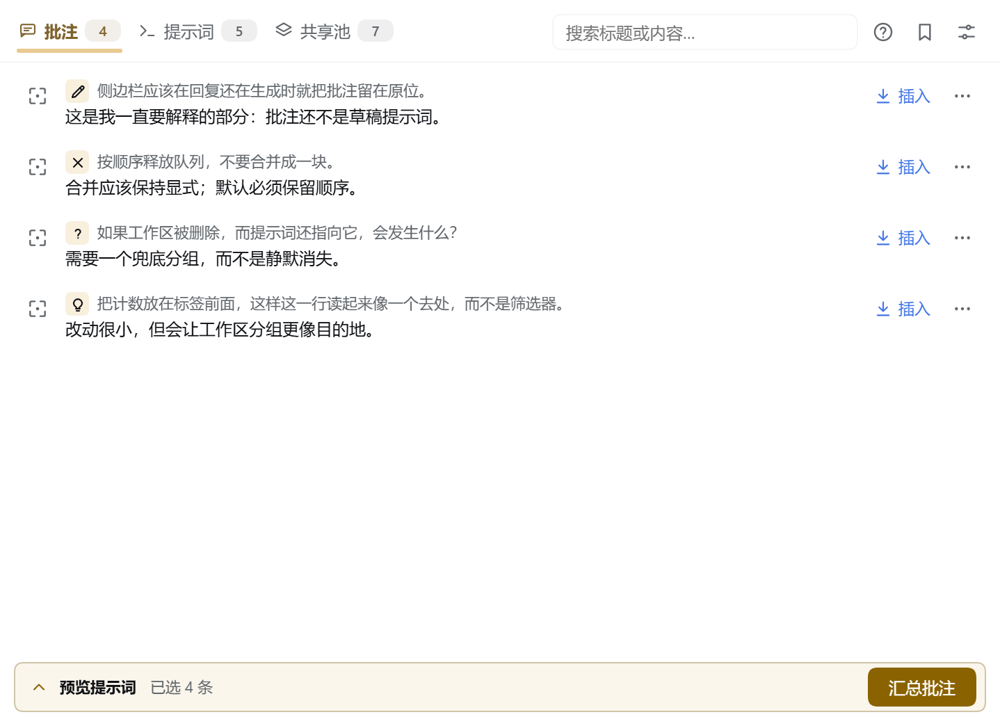
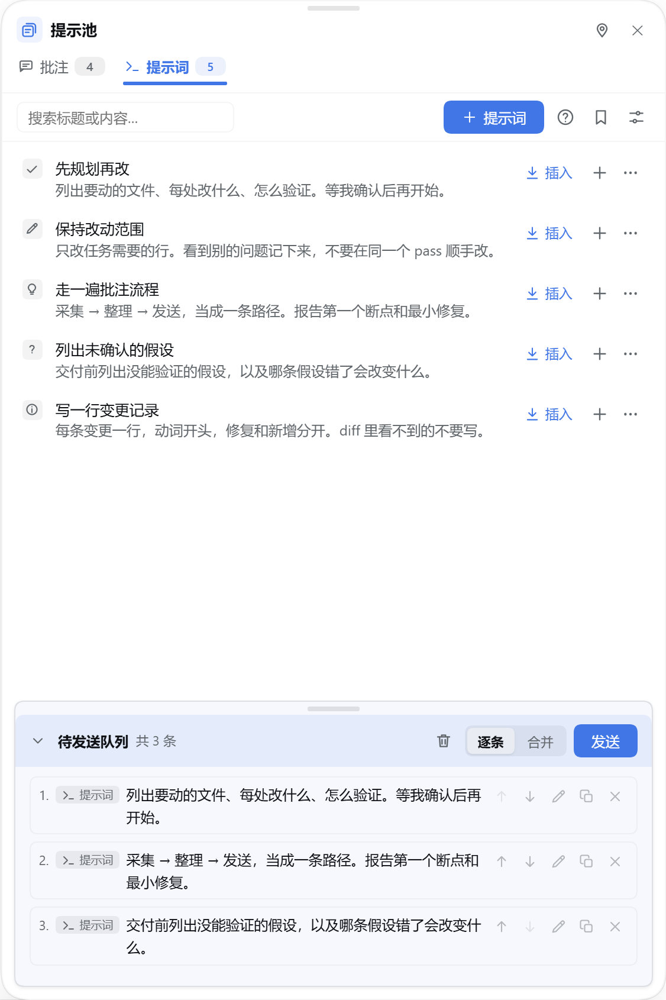
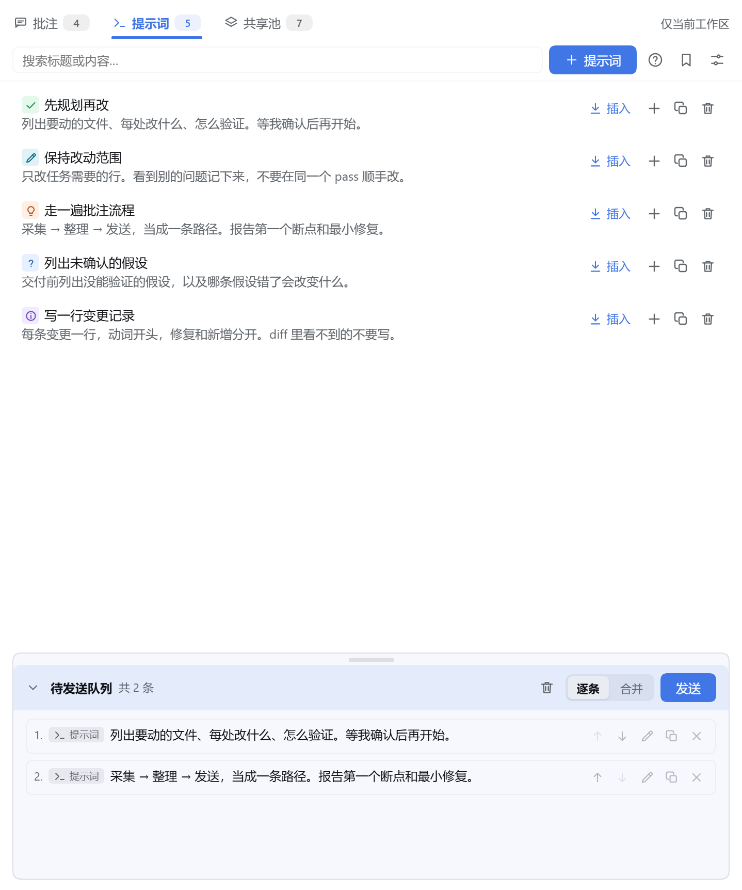
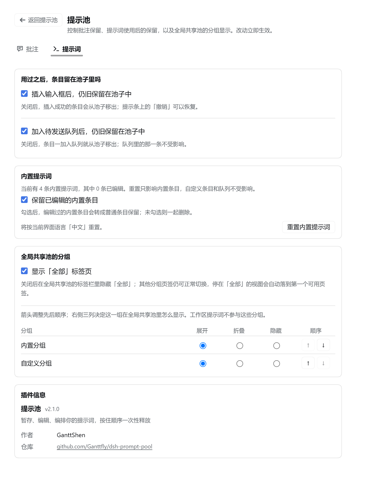

# 提示池 · Prompt pool

[](https://www.npmjs.com/package/dsh-prompt-pool) [](https://dshfind.com/zh/plugins/Ganttfly/dsh-prompt-pool?ref=badge)

[English](README.md) | 中文

DeepSeek Harness 里的提示词暂存池：草稿还没想好时先放在池子里，不急着发给 agent；把接下来要发的
提示词排好顺序；读长回复时直接在原文上批注，不用把要点另抄一份。

它有两个入口：输入框旁的按钮，以及右侧栏里的整页。

## 界面



**边读边批注。** 选中一句话，批注直接落在原文旁边，不用离开答复；原句会一起保留，上下文更容易看懂，
要点也不容易漏。右侧「当前会话」页签汇总当前会话的批注：可以定位回原文、插入单条、存成提示词，或把每条连同原话
生成一条编号草稿。批注只属于当前会话，不会混入其他会话。



输入框面板分「批注 / 提示词」两个作用域：批注关注当前会话，提示词只显示当前工作区。提示词行有插入 / 入队 /
编辑 / 复制 / 删除，底部是共用的待发送队列；作用域切换不改变列表行样式。



右侧栏里的整页视图——DSH 0.2+ 是原生 Tab，分「当前会话 / 当前工作区 / 全局共享池」。工作区提示词用 tag
筛选；全局共享池保留内置分组与自定义分组。存成提示词时会先进入一个保存步骤，可以修改标题、正文、图片、类型和
分组，并提示保存后不再保留会话上下文。



设置：批注按当前会话保存；汇总审阅或存成提示词后是否保留，以及插件信息。

## 为什么需要提示池？

和 agent 协作很少是“发一条提示词”就结束，真正的摩擦发生在消息之间：

| 痛点 | 提示池怎么解决 |
|---|---|
| 提示词还没打磨好，手一滑就发出去了。 | 先存进分组；不点释放，agent 不会执行。 |
| 接下来要发的几条提示词已经在脑子里，重新打字会打断节奏。 | 按顺序加入队列，逐条释放，有进度和「停止」。 |
| 长回复只想针对某一句话给意见，笼统说“看起来不错”又太含糊。 | 直接在原文上批注；批注跟着原句走，「汇总审阅」把勾选的批注连同原话送进会话队列。 |
| 关键约束在之前的消息或另一个工作区里。 | 右键把选中内容存进分组，工作区 Tab 把上下文放在一起。 |

它不是另一个笔记软件，而是把上下文、原话和下一步动作留在对话旁边：agent 收到的是精确指令，你也不丢线索。

## 功能

- **暂存而不是发送**——写一半的提示词先存进池子，不释放就不会执行。
- **按顺序释放**——队列里的条目按你排的顺序逐条送进输入框；每一条都等前一条被宿主接受后再发下一条。
  宿主提供会话队列接口时，条目直接进入队列，不经过输入框；没有该接口时退回输入框路径。释放期间两个视图
  都会显示进度和「停止」，队列在结束前锁定。
- **一键移交**——输入框上方多一条窄条，和宿主自己的「排队消息」并排显示两边条数；点「压入队列」把待发送
  队列按顺序交给宿主队列，不占用输入框，也不走释放进度遮罩。压入成功的条目会离开发送队列；宿主没有入队
  接口时它们原样保留并给出提示。
- **边读边批注**——在助手回复里选中一句话右键「批注」，在二级菜单里选一个类型（同意 / 反对 / 提问 / 意见 /
  思路 / 补充信息 / 待办），气泡会以该类型打开；再写最多 100 个全角或 200 个半角字符（也可以留空，只留一个图标），
  色块就落在原文后面，原文用同色下划线标出；色块跟随会话区的字号，正文放大时一起放大。没有在菜单里选类型
  时，新批注默认选择「同意」；可以在气泡里添加图片或直接粘贴图片，缩略图会跟着这条批注保存，并随汇总送审
  和存成提示词一起带走。
  批注和原句绑定，读到哪批到哪，回头看的是原话而不是脱离上下文的摘要，要点不容易漏；点色块即可编辑。
  提示池的 **当前会话** 页签汇总当前会话的批注：每行最前面有复选框（默认全选）；**定位** 滚回原文，**插入** 把单条
  写进输入框，**存成提示词** 会先打开一个保存步骤，可以改标题、正文、图片、类型和分组，并提示保存后不再保留
  会话上下文。标题栏的 **汇总审阅** 会在底部打开一张类似待发送队列的审阅卡片：调整勾选的批注，编辑提示词，然后
  **发送到会话队列**，不占用输入框。批注完成后点 **「预览提示词」** 查看生成的提示词，可直接发送，也可返回批注重新调整。
  提示词按类型分组写回应要求；补充信息用于结合新信息重新检查相关结论，
  不执行动作。意见、思路、同意可以分别勾选
  **采纳时立即实施 / 可行时立即实施 / 按此方案立即实施**；待办用两个单选：**立即实施 / 存为提示词**，
  默认存为提示词。只有判断无需进一步商讨时才在同一轮执行；提问、反对和补充信息没有立即实施选项。
  存为提示词的待办不会发送，而是存入当前工作区的提示池。发送成功后
  已发送的批注从批注列表移除，待办已在提示池里，批次记录保留审计；不再维护「未处理 / 已处理」状态和筛选。
  已存入的批注保留绿色标记；批注按会话保存，刷新后还在，不进入其他会话的列表。
- **提示词类型**——每条提示词最多一个固定类型：决策 / 问题 / 意见 / 思路 / 补充 / 待办 / 灵感，也可以留空为
  未分类。批注转提示词时自动预填（同意和反对都归为决策）；类型可以在保存步骤或编辑框里改，列表顶部可以按类型筛选。
  模板、工作习惯、便签是分组，不是类型。
- **输入框面板**——搜索、当前工作区提示词列表、类型筛选、行内 插入 / 入队 / 编辑 / 复制 / 删除，底部是待发送队列卡片
  （折叠、清空、发送）。顶部边缘可以拖动改高度，左边缘可以拖动改宽度；点「钉住」后点面板外面也不会关。
  面板分「批注 / 提示词」两个作用域，默认停留在批注；不在面板里放全局共享池。
- **侧栏页**——同一套数据的完整工作台，分「当前会话 / 当前工作区 / 全局共享池」。工作区提示词用类型筛选；
  全局共享池保留分组 Tab，可以继续管理内置与自定义分组。默认停留在当前会话。
- **保存步骤**——批注转提示词不再直接落库，而是先确认标题、正文、图片、类型和目标分组；保存前会提示
  内容需要能独立成立。批注的原文、会话和节点信息不会跟着提示词走。
- **右键存段落**——在回复或自己的消息里选中文字后右键，菜单里有「复制」和「添加到提示池」，展开子菜单
  选一个分组，就把选中的内容存成该分组的新条目；上次用的分组排在子菜单最前面。Shift+F10 也能打开同一个
  菜单，没有选中文字时仍是浏览器原生菜单。
- **分组**——全局共享池保留内置 常用 / 便签 / 模板，以及自定义分组；每个工作区另有自己的工作区提示词池，
  不参与全局分组。分组可以展开、折叠成一个 Tab，或隐藏；「全部」Tab 也可以在设置里隐藏。
- **种子文案跟随语言**——新建的池子按宿主语言写入种子；设置 → 提示词里可以按当前界面语言重置内置条目，编辑过的内置项可保留为普通条目，自定义条目和队列不受影响。
- **设置**——分组的顺序与显示方式（包括是否显示「全部」Tab）、显示哪些工作区、两个插入/入队后的保留开关、按当前界面语言重置内置提示词，以及一个 **批注** 页签（说明批注与会话的绑定关系，并提供「存为提示词后保留」开关，默认开启）。
- **破坏性操作有确认**——删除条目、清空队列、移出队列条目都会先问；删除和清空还能在提示条上撤销。
- **中英双语**——所有文案跟随宿主语言，包括侧栏 Tab 名。

## 安装

包已发布到 npm（[`dsh-prompt-pool`](https://www.npmjs.com/package/dsh-prompt-pool)）。等社区市场收录后，可以在 设置 → 插件 的市场里直接装，或用命令行：

```powershell
dsh plugin add dsh-prompt-pool --profile <profile>
```

用 tarball 也一样：

```powershell
dsh plugin add ./dsh-prompt-pool-<version>.tgz --profile <profile>
```

装完要在 **设置 → 插件** 里启用这个 bundle——它是个 bundle，只装包不会自动开启。

## 使用

1. 点输入框旁的 **提示池**，或打开侧栏页。
2. **保存草稿** 会把输入框的内容（文字 + 图片附件）复制进池子，并弹出一个小窗口列出当前 Tab 栏里展示的
   分组（内置、自定义，以及所有当前展示的工作区）；提示条会说明存到了哪里。输入框里的字保留。
3. 在对话里选中文字后右键：菜单里有「复制」和「添加到提示池」，展开子菜单选一个分组，就把选中内容存成
   该分组的新条目。
4. 想逐段点评时改用「批注」：选好类型，写最多 100 个全角或 200 个半角字符，色块会出现在原文后面。提示池里会多出「批注」页签，
   每行前面有复选框；「定位」滚到原文，「插入」把单条批注写进输入框，「存成提示词」把单条批注存进分组，
   「汇总审阅」在底部打开一张审阅卡片：调整勾选的批注，意见 / 思路 / 同意按需勾选「立即实施」，
   待办选择「立即实施」或「存为提示词」，确认后直接发送到会话队列，不经过输入框；
   发送成功后这些批注从列表移除，存为提示词的待办存入当前工作区的提示池。
5. 用 ⊕ 把条目加入队列，在队列卡片里调整顺序，然后点 **发送**。
6. 队列里的条目会被逐条写进输入框并提交。

## 兼容性

- DSH **>= 0.2.0-rc.1**，实测 **0.2.2-rc.1**。
- 右键菜单依赖会话区的文本交互服务（0.2.2-rc.1 已有）；没有该服务的宿主仍用原生菜单，面板、整页与保存草稿
  不受影响。
- 侧栏页优先使用宿主自带的右侧栏 Tab 注册表（DSH 0.2+）；没有时回退到
  [`dsh-better-sidebar`](https://github.com/omdsh-dev/DSH-better-sidebar)；两者都没有时，输入框面板与设置页仍然可用。

## 数据

- 条目与设置：`localStorage["dsh.prompt-pool.v1"]`
- 批注：`localStorage["dsh.prompt-pool.notes.v1"]`
- 池子里的图片：IndexedDB `dsh-prompt-pool-images.v1`
- 存储结构升级前，旧数据会先复制一份到 `localStorage["dsh.prompt-pool.v1.backup"]`
- 写入失败（存储已满或被禁用）时，页面会明确提示"没有保存"
- 没有任何条目引用的图片会在启动时清理；在编辑器里移除并保存的图片会立即删除

卸载插件**不会**删除这几处数据，重新安装后池子还在；要彻底清掉需要手动删除。

## 已知限制

- **非图片附件不会被捕获**。输入框里的浏览器文件能读到，但池子只存图片；捕获时会提示有多少个附件没被保存。
- **引用芯片会退化成文本**。存下的条目如果引用了文件或会话，正文保留引用文本（模型仍能看到），但回插到输入框时是纯文本，不是可点的芯片——宿主没有开放重建芯片的接口。
- **右键菜单只覆盖对话正文**。回复、自己的消息和展开的推理正文可以选中；工具卡片、侧栏和输入框仍是各自
  的原生菜单。
- **选中文字后右键会替换浏览器原生菜单**。菜单自己带了「复制」，但原菜单里的「搜索 / 翻译 / 检查」不再
  出现。
- **批注标记跟着已渲染的正文走**。回复被折叠或滚出 DOM 时，批注仍留在输入框上方的列表里，但正文上没有
  卡片、圆点或高亮；汇总审阅照样用它。
- **卡片可能压住原文下方的几行**。它紧贴原文末尾，短行上的批注会盖住右侧接下来的文字；完整列表始终在
  输入框上方的坞里。
- **保存草稿不会清空输入框**。它是复制；要清空请用编辑器自己的清空操作。

## 开发

```powershell
npm run check                       # lint + 完整测试，CI 跑的就是这个
npm run lint                        # 语法、版本一致性、中英 key 对齐与死 key
npm test                            # 通过 tools/run-tests.js 跑完整测试
node tools/smoke.js                 # 模块加载、槽位注册、语言切换改名、版本一致性
node tools/render-smoke.js          # 每个槽位能渲染；面板与设置的结构断言
Get-ChildItem tools/verify/*.js | ForEach-Object { node $_.FullName }   # 行为检查
```

GitHub Actions 会在每次 push / pull request 时跑同一个 `npm test`。

面板的高度在真浏览器里量，不靠肉眼：需要把 playwright 放进 `NODE_PATH`，再准备一份 `react` /
`react-dom` 供页面加载（装到 `%TEMP%\pp-harness` 一次即可，或用 `PP_VENDOR` 指向已有的 `node_modules`）。

```powershell
pnpm --dir "$env:TEMP\pp-harness" add react@18 react-dom@18
$env:NODE_PATH = "$env:DSH_PROFILE_DIR\node_modules"
node tools/panel-geometry/run.js --viewport 1280x760 --composer 0.34 --drag --shot panel-height
node tools/panel-geometry/run.js --viewport 1280x900 --composer 0.9 --tray 6 --shot queue-card
```

`--composer` 把输入框放在窗口中部（新会话的样子）。模拟页面保留了顶部栏和会裁剪溢出的会话面板，所以
面板标题被裁掉、或被自己的盒子滚出视野时，这次运行会直接报错；`--tray N` 预置待发送队列，队列还短就
出现滚动条同样会报错。

包本体在 `plugin/`；`tools/` 只用于开发，`_shots/` 是本地的截图暂存目录，不进仓库。

## License

MIT
