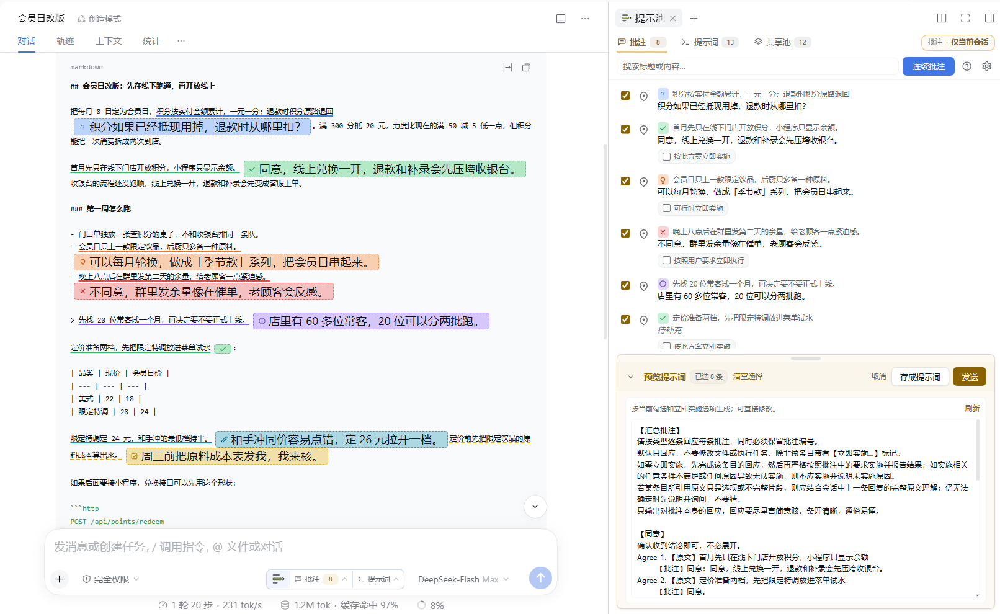
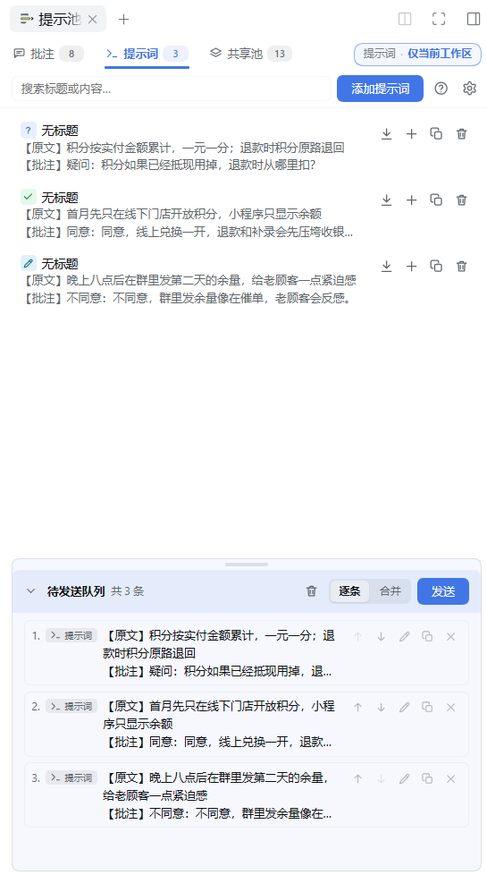
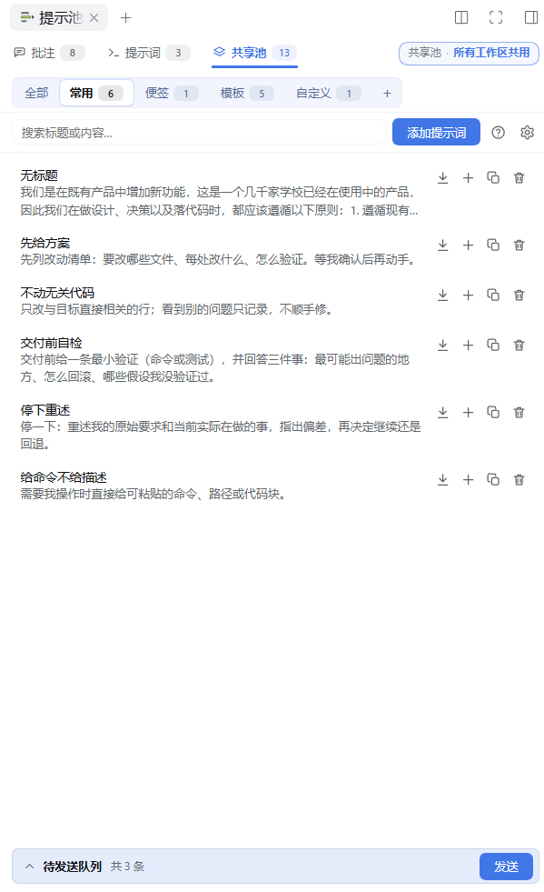

# 提示池 · Prompt pool

[](https://www.npmjs.com/package/dsh-prompt-pool) [](https://dshfind.com/zh/plugins/Ganttfly/dsh-prompt-pool?ref=badge)

[English](README.md) | 中文

DeepSeek Harness 里的提示词暂存池：草稿还没想好时先放在池子里，不急着发给 agent；把接下来要发的
提示词排好顺序；读长回复时直接在原文上批注，不用把要点另抄一份。

它有两个入口：输入框旁的分段按钮，以及右侧栏里的整页——整页分「批注」「提示词」「共享池」三个目的地。

## 界面



**边读边批，再一次说清。** 选中一句话右键「划词批注」，批注就钉在这几个字上；或者选「连续批注」，
在助手回复的段落上一段接一段地点：琥珀色描边和「段落 · 42 字」标签先标出这一块，点一下才落下批注，
拾取不会中断，点下一段就接着加。「批注」页按原文顺序列出当前会话的批注——定位回原文、把单条插入输入框、
就地把原文改成想要的说法、存成提示词。勾选后点「一键汇总」打开「预览提示词」卡：行内勾选、立即实施和待办分流，
卡片把选中的批注生成一条可编辑的提示词，底部是「取消 / 存成提示词 / 发送」。



**提示词只属于当前工作区，队列是它们排队的地方。** 每行前面是可选类型徽标——决策、提问、意见、思路、
补充、待办或灵感——行内是插入、入队、复制和删除，点标题进入编辑。「待发送队列」只放提示词，默认收成一条窄条，
头部可以在「逐条」和「合并」之间切换。队列里的每一行用记号说明它是什么——提示词带自己的类型、汇总带汇总记号、
批注带它的批注类型——而不是再写一遍文字标签。



**共享池**跨工作区共用：内置「常用 / 便签 / 模板」，外加自定义分组。每个分组族可以展开、折叠成一个 Tab，
或隐藏；折叠后组名仍以芯片形式带条数列在下面，而那个 Tab 本身代表整族。混装列表会在每行末尾标出它属于哪个组。
页头那一行还会点明当前目的地的作用域——「提示词 · 仅当前工作区」「批注 · 仅当前会话」「共享池 · 所有工作区共用」，
胶囊的琥珀或蓝色跟着那个 Tab 走。

## 为什么需要提示池？

和 agent 协作很少是“发一条提示词”就结束，真正的摩擦发生在消息之间：

| 痛点 | 提示池怎么解决 |
|---|---|
| 提示词还没打磨好，手一滑就发出去了。 | 先存进分组；不点释放，agent 不会执行。 |
| 接下来要发的几条提示词已经在脑子里，重新打字会打断节奏。 | 按顺序加入队列，逐条释放，有进度和「停止」。 |
| 长回复只想针对某一句话给意见，笼统说“看起来不错”又太含糊。 | 直接在原文上批注；批注跟着原句走，可以单独整理，也可以合并成一条带引用的指令。 |
| 关键约束在之前的消息或另一个工作区里。 | 右键把选中内容存进当前工作区或共享池；「提示词」页把当前项目的提示词放在一起。 |

它不是另一个笔记软件，而是把上下文、原话和下一步动作留在对话旁边：agent 收到的是精确指令，你也不丢线索。

## 功能

- **暂存而不是发送**——放进池子的草稿不会自己跑出去，不释放 agent 就不会执行。「保存草稿」只在输入框旁的
  「提示词」菜单里：它把输入框的文字和图片复制进当前工作区或共享池分组（一个小弹窗给出两边的分组），
  输入框里的字保留。页头不再单独放这个动作，命令就贴在它复制的内容旁边。
- **待发送队列**——只放提示词，也只出现在提示词在的地方：「提示词」「共享池」两个目的地，以及面板的
  「提示词」模式。行内「＋」加入；头部在「逐条」和「合并」之间切换，队列行可以上移下移、编辑、复制或移出。
  逐条会写进宿主的会话队列，并等上一条被接受后再发下一条；宿主没有该接口时退回输入框路径。「合并」先预览
  全部队列条目（图片以缩略图列出），确认后作为一条消息发出。释放期间显示进度和「停止」，队列在结束前锁定。
  队列空着时不会消失，而是收成一条虚线的窄条——「空着；在提示词行点「＋」加入。」——列表底部不会随着队列
  有无上下移动。
- **边读边批注**——在助手回复里选中一句话右键「划词批注」，在二级菜单里选类型：批注、提问、同意、反对、
  意见、补充信息、待办。正文最多 500 个全角或 1,000 个半角字符，也可以留空，只留一个类型图标。色块落在原文
  后面，原文用同色下划线标出，每种类型在徽标、行内芯片和下划线上共用同一个鲜明颜色。点徽标，或者直接点
  被批注的那几个字，都能重新打开气泡；图片可以从气泡里加，也可以直接粘贴。
- **指向段落**——「批注」页头的「连续批注」，或「批注」菜单的第一项，会进入段落拾取。只接受助手回复：段落、
  列表项、标题、引用、代码块和表格单元会在指针下显出琥珀色描边和字数标签，点一下就添加一条批注，并在段落旁
  弹出编辑气泡。拾取不会结束，右侧栏保持原来状态，批注列表也不会跳进编辑态。正文留空、只选类型也能保存；
  没写正文、没加图片也没保存就关掉，会丢弃这次拾取，不留空徽标。同一段已有整段批注时，再次点击直接打开
  原批注。底部状态条只显示「已添加 N 条」和「完成」；按 Esc 或点会话外退出。自己的提问、纯图片和空块会被
  拒绝；拾取只作用于会话正文，输入框和轮次栏照常可用。
- **连续批注记住类型**——气泡里选的类型会成为下一次拾取的默认值，拾取器也会停在这个页面上次用过的类型上
  （首次为「批注」）；右键划词没有经过拾取时，新批注默认是「同意」。
- **「批注」页**——当前会话的批注按原文顺序排列。「定位到原文位置」带一个地图钉，把会话滚回那几个字；
  「插入输入框」把单条写成固定格式的一段话——先【原文】那句话，再【批注】<类型>：你写的意见；
  「存成提示词」把这个批注交给提示池的编辑行。点批注正文可以就地改类型和内容，引用的原文只读。
  新增的批注会自动滚入视野，并在几秒内带「刚刚添加」的琥珀标记；存成提示词过的批注留一个绿色标记。
  批注属于它自己的会话，刷新后还在，也不会出现在别的会话里。
- **预览提示词**——底部的「一键汇总」打开整理卡：它像待发送队列一样停在底部，可以收起，也能拖动顶部调整
  高度（双击复位）。行内出现勾选框、立即实施和待办分流，定位保留，插入 / 存成提示词 / 删除隐藏。卡片就是
  提示词的编辑器：把勾选的批注生成成每条一个编号块（编号保留为 Agree-1、Question-2……），可以预览、直接改写，
  「刷新」重新生成。提示词开头写清回应约定，一行一条：按类型逐条回应并保留编号；默认只回应，不修改文件、
  不执行任务，除非条目带【立即实施…】标记；需要实施时先回应这一条，再按要求做并报告结果；引用只是选项或
  不完整片段时，结合上一条回复的完整原文理解，仍不确定就问，不要猜。卡片头按用途分开：左边是类型芯片和
  「全选 / 清空」（只在能起作用时出现），右边是「取消 / 存成提示词 / 发送」。取消只是退出汇总、收起卡片，
  勾选、写了一半的提示词和队列都不动。批注永远不进待发送队列，单条批注也没有直接发送按钮。
- **批注存成提示词**——有侧栏整页时，提示池直接切到「提示词」并打开自己的编辑行：正文是【原文】/【批注】
  两行，标题留空，类型自动跟着批注走（同意存成决策，反对和意见存成意见，其余同名对应），图片一起带过来。
  汇总的一批也这样进去——不带标题，每条一个编号块，勾选的批注类型一致时才带类型。没有侧栏的宿主（输入框
  上方的面板）、没有工作区的会话，或整页已经占着一个草稿时，仍然退回独立的保存步骤。批注的原文、会话和
  节点信息不会跟着提示词走。
- **输入框面板**——顶部品牌行（提示池标记、名称、固定和关闭），搜索、当前工作区的提示词列表，行内「插入 /
  ＋ / 复制 / 删除」，底部是共用的待发送队列。面板默认停在批注模式，提示词和队列在提示词模式里。两个编辑器
  共用同一张卡片：标题行、类型芯片、正文、附加行和操作行，切换批注与提示词时节奏不变。添加图片的 ＋ 在
  正文框内部，正文按显示宽度计算并显示实时计数，`@` 可以引用文件。有未保存内容时切换项目，会先问继续编辑、
  不保存还是保存并切换。顶部边缘拖高度，左边缘拖宽度，点「钉住」后面板压着会话也不关。搜索行右侧是使用
  说明和设置。
- **侧栏整页**——同一套数据的完整工作台，分「批注」「提示词」（只放当前工作区）和「共享池」（跨工作区的
  内置与自定义分组）三个目的地，默认停留在批注。共享池的分组 Tab 单独占一行，夹在目的地和搜索框之间；
  整页用满宿主宽度。
- **输入框旁的入口**——一条分段按钮。品牌段打开侧栏整页并保持页面当前目的地；「批注」菜单给出「连续批注」
  「一键汇总」（带当前会话的条数）和打开批注列表；「提示词」菜单给出「保存草稿」「添加提示词」和打开提示词
  列表。两个菜单里每一行都有自己的记号——指针、漏斗、批注气泡、托盘、方框加号、提示词折角——并各自用
  批注的琥珀或提示词的蓝色；两个菜单都只通向整页。宿主没有右侧栏时，品牌段和菜单改用面板。
- **右键存段落**——在回复或自己的消息里选中文字后右键，菜单里有「复制」和「添加到提示池」，展开子菜单
  选一个分组，就把选中的内容存成该分组的新条目；上次用的分组排在子菜单最前面。Shift+F10 也能打开同一个
  菜单，没有选中文字时仍是浏览器原生菜单。
- **分组**——共享池保留内置「常用 / 便签 / 模板」，以及自定义分组；每个工作区另有自己的工作区提示词池，
  不参与共享池分组。每个分组族可以展开、折叠成一个 Tab，或隐藏，三种选择就写在这一行上。折叠后那个 Tab
  仍保留全部条目，下面多一行组芯片（各组名＋条数），点一个芯片就只看那一组，新建的条目也落进那个组；
  再点当前芯片、或点回该 Tab，就回到整族。只有一个组的分组族不显示芯片行。「全部」Tab 也可以在设置里隐藏。
- **种子文案跟随语言**——新建的池子按宿主语言写入种子；设置 → 提示词里可以按当前界面语言重置内置条目，
  勾选后编辑过的内置项会保留成普通条目，自定义条目和队列不受影响，按钮的悬停提示会先说清要重置成哪种语言。
- **设置**——一个独立目的地，分两节，默认打开「批注」。「批注」放三个保留开关：插入输入框后、汇总发送后、
  存成提示词后，批注是否还留在列表里（插入默认保留，汇总发送默认移除；关掉时那条批注离开列表，提示条带
  「撤销」）。「提示词」放插入/入队后的保留、内置提示词重置，以及共享池的分组顺序与显示方式。插件卡片只
  留作者和仓库，版本放在标题旁。工作区不再有独立的设置页：保存和捕获的目标只有当前工作区和共享池。
- **破坏性操作有确认**——删除条目、清空队列、移出队列条目都会先问；删除和清空还能在提示条上撤销。
- **中英双语**——所有文案跟随宿主语言，包括侧栏 Tab 名；两种语言只在措辞上不同，布局不变。

## 安装

包已发布到 npm（[`dsh-prompt-pool`](https://www.npmjs.com/package/dsh-prompt-pool)）。等社区市场收录后，可以在 设置 → 插件 的市场里直接装，或用命令行：

```powershell
dsh plugin add dsh-prompt-pool --profile <profile>
```

用 tarball 也一样：

```powershell
dsh plugin add ./dsh-prompt-pool-<version>.tgz --profile <profile>
```

装完要在 **设置 → 插件** 里启用这个 bundle——它是个 bundle，只装包不会自动开启。

## 使用

1. 点输入框旁的 **提示池**，或打开侧栏整页。
2. 打开入口的「提示词」菜单，点 **保存草稿**：小弹窗给出当前工作区和共享池的分组，提示条会说明存到了哪里。
   输入框里的字保留。
3. 想留下原文，就在会话里选中文字右键「添加到提示池」，再选一个分组。
4. 想逐段点评，右键选 **划词批注**；或者从页头（或菜单）进入 **连续批注**，在助手回复上一段接一段地点。
   选好类型、写好正文后保存。批注都汇总在 **批注** 页：**定位到原文位置** 滚回原文，**插入输入框** 写进
   输入框，**存成提示词** 图标把它开成草稿，点正文可以就地修改。勾选后点 **一键汇总**，在卡片里勾选、
   分流、需要立即做的标记出来，提示词可以再改，然后 **存成提示词** 或 **发送**；**取消** 退出汇总，
   别的什么都不动。
5. 用提示词行的 **＋** 加入待发送队列；点开收起的窄条，用箭头排序，然后 **逐条** 发送，或切到 **合并** 预览。
6. 逐条会按顺序一条条送进会话队列；合并把队列合成一条消息发出。两者都能中途停止，没发出去的条目留在队列里。

## 兼容性

- DSH **>= 0.2.0-rc.1**，实测 **0.2.2-rc.1**。
- 右键菜单依赖会话区的文本交互服务（0.2.2-rc.1 已有）；没有该服务的宿主仍用原生菜单，面板、整页与保存草稿
  不受影响。
- 侧栏整页优先使用宿主自带的右侧栏 Tab 注册表（DSH 0.2+）；没有时回退到
  [`dsh-better-sidebar`](https://github.com/omdsh-dev/DSH-better-sidebar)；两者都没有时，输入框面板与设置页仍然可用。

## 数据

- 条目与设置：`localStorage["dsh.prompt-pool.v1"]`
- 批注：`localStorage["dsh.prompt-pool.notes.v1"]`
- 池子里的图片：IndexedDB `dsh-prompt-pool-images.v1`
- 存储结构升级前，旧数据会先复制一份到 `localStorage["dsh.prompt-pool.v1.backup"]`
- 写入失败（存储已满或被禁用）时，页面会明确提示“没有保存”
- 没有任何条目引用的图片会在启动时清理；在编辑器里移除并保存的图片会立即删除

卸载插件**不会**删除这几处数据，重新安装后池子还在；要彻底清掉需要手动删除。

## 已知限制

- **非图片附件不会被捕获**。输入框里的浏览器文件能读到，但池子只存图片；捕获时会提示有多少个附件没被保存。
- **引用芯片会退化成文本**。存下的条目如果引用了文件或会话，正文保留引用文本（模型仍能看到），但回插到
  输入框时是纯文本，不是可点的芯片——宿主没有开放重建芯片的接口。
- **右键菜单只覆盖对话正文**。回复、自己的消息和展开的推理正文可以选中；工具卡片、侧栏和输入框仍是各自
  的原生菜单。
- **选中文字后右键会替换浏览器原生菜单**。菜单自己带了「复制」，但原菜单里的「搜索 / 翻译 / 检查」不再出现。
- **批注标记跟着已渲染的正文走**。回复被折叠或滚出 DOM 时，批注仍留在「批注」页的列表里，但正文上没有
  徽标或高亮；定位、插入和存成提示词仍可用。
- **气泡可能压住原文下方的几行**。它紧贴原文末尾，短行上的批注会盖住右侧接下来的文字；完整列表始终在
  「批注」页里。
- **保存草稿不会清空输入框**。它是复制；要清空请用编辑器自己的清空操作。

## 开发

```powershell
npm run check                       # lint + 完整测试，CI 跑的就是这个
npm run lint                        # 语法、版本一致性、中英 key 对齐与死 key
npm test                            # 通过 tools/run-tests.js 跑完整测试
node tools/smoke.js                 # 模块加载、槽位注册、语言切换改名、版本一致性
node tools/render-smoke.js          # 每个槽位能渲染；面板与设置的结构断言
Get-ChildItem tools/verify/*.js | ForEach-Object { node $_.FullName }   # 行为检查
```

GitHub Actions 会在每次 push / pull request 时跑同一个 `npm test`。

面板的高度在真浏览器里量，不靠肉眼：需要把 playwright 放进 `NODE_PATH`，再准备一份 `react` /
`react-dom` 供页面加载（装到 `%TEMP%\pp-harness` 一次即可，或用 `PP_VENDOR` 指向已有的 `node_modules`）。

```powershell
pnpm --dir "$env:TEMP\pp-harness" add react@18 react-dom@18
$env:NODE_PATH = "$env:DSH_PROFILE_DIR\node_modules"
node tools/panel-geometry/run.js --viewport 1280x760 --composer 0.34 --drag --shot panel-height
node tools/panel-geometry/run.js --viewport 1280x900 --composer 0.9 --tray 6 --shot queue-card
```

`--composer` 把输入框放在窗口中部（新会话的样子）。模拟页面保留了顶部栏和会裁剪溢出的会话面板，所以
面板标题被裁掉、或被自己的盒子滚出视野时，这次运行会直接报错；`--tray N` 预置待发送队列，队列还短就
出现滚动条同样会报错。

包本体在 `plugin/`；`tools/` 只用于开发，`_shots/` 是本地的截图暂存目录，不进仓库。

## License

MIT
