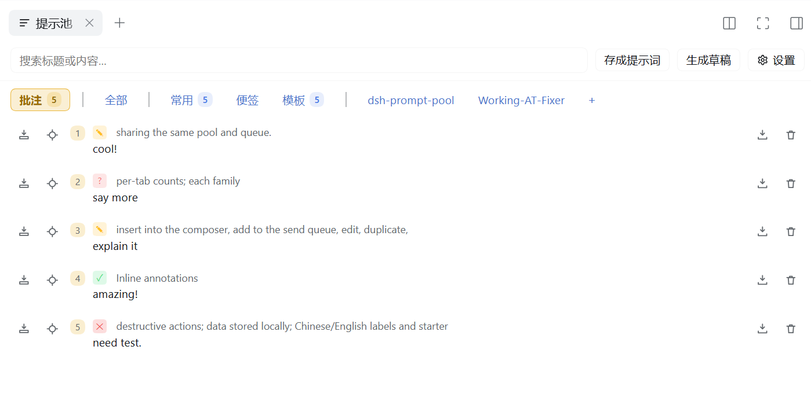
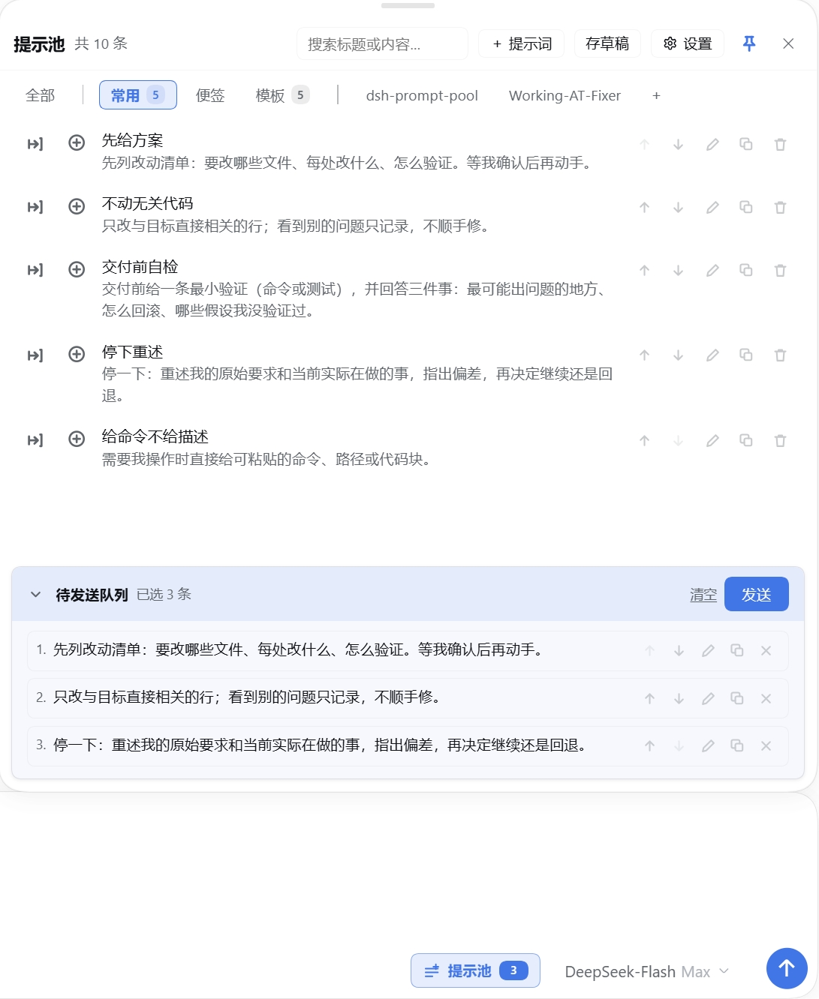
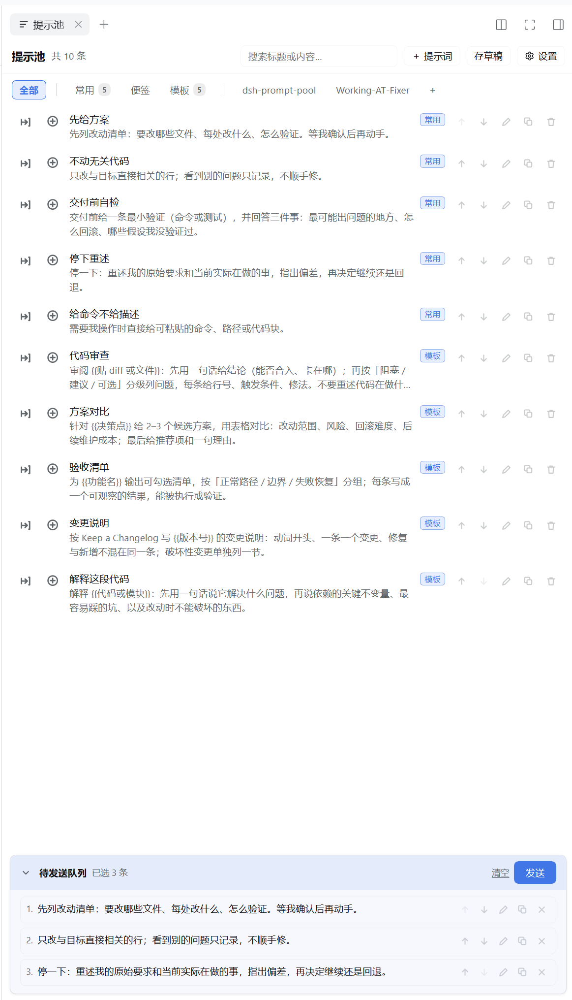
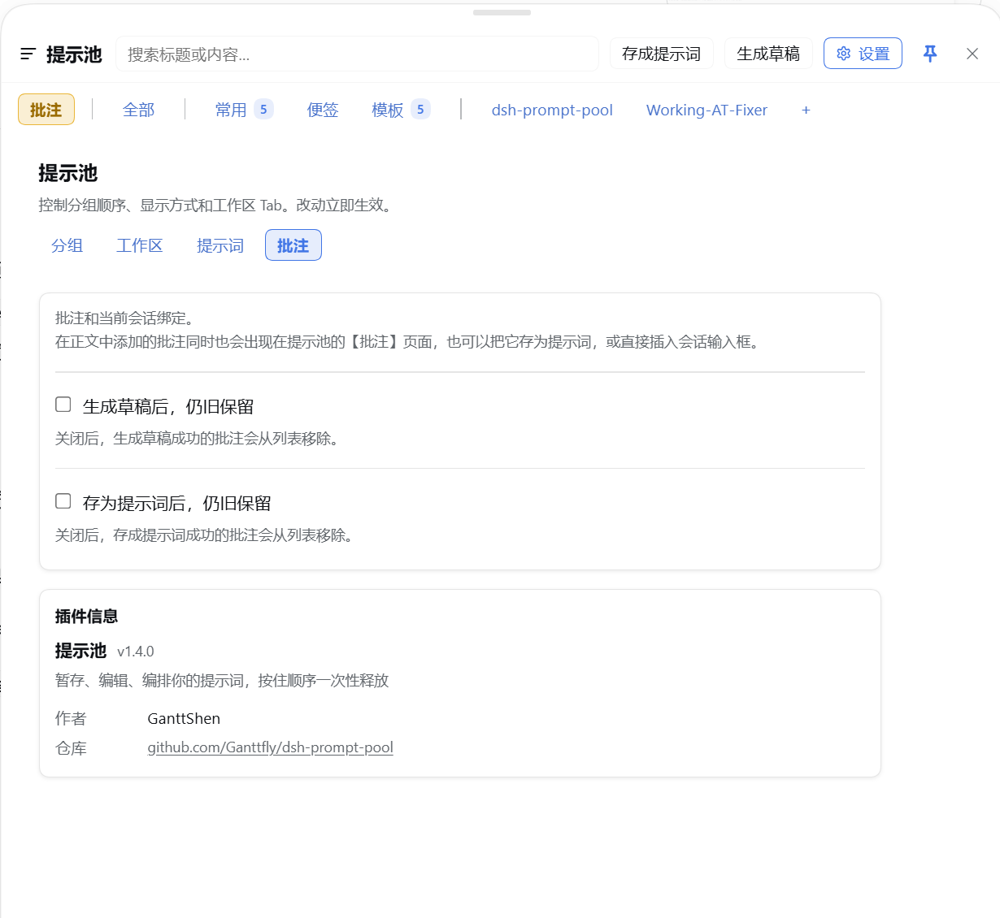

# 提示池 · Prompt pool

[](https://www.npmjs.com/package/dsh-prompt-pool) [](https://dshfind.com/zh/plugins/Ganttfly/dsh-prompt-pool?ref=badge)

[English](README.md) | 中文

DeepSeek Harness 里的提示词暂存池：草稿先存着不会被执行，排好顺序后一次性释放进输入框的发送队列。

它有两个入口：输入框旁的按钮，以及右侧栏里的整页。

## 界面



**边读边批注。** 选中一句话，批注直接落在原文旁边，不用离开答复；原句会一起保留，上下文更容易看懂，
要点也不容易漏。右侧「批注」页签汇总全部批注：可以定位回原文、插入单条、存成提示词，或把每条连同原话
生成一条编号草稿。



输入框面板：分组 Tab 带条数，每行有插入 / 入队 / 编辑 / 复制 / 删除，底部是待发送队列；右侧「提示池」入口显示队列条数。



右侧栏里的整页视图——DSH 0.2+ 是原生 Tab，带分组 Tab 与「每个工作区一个 Tab」。



设置：批注按当前会话保存；生成草稿或存成提示词后是否保留，以及插件信息。

## 功能

- **暂存而不是发送**——写一半的提示词先存进池子，不释放就不会执行。
- **种子文案跟随语言**——新建的池子按宿主语言写入种子；设置 → 提示词里可以按当前界面语言重置内置条目，编辑过的内置项可保留为普通条目，自定义条目和队列不受影响。
- **按顺序释放**——队列里的条目按你排的顺序逐条送进输入框；每一条都等前一条被宿主接受后再发下一条。
  宿主提供会话队列接口时，条目直接进入队列，不经过输入框；没有该接口时退回输入框路径。释放期间两个视图
  都会显示进度和「停止」，队列在结束前锁定。
- **右键存段落**——在回复或自己的消息里选中文字后右键，菜单里有「复制」和「添加到提示池」，展开子菜单
  选一个分组，就把选中的内容存成该分组的新条目；上次用的分组排在子菜单最前面。Shift+F10 也能打开同一个
  菜单，没有选中文字时仍是浏览器原生菜单。
- **边读边批注**——在助手回复里选中一句话右键「批注」，选一个类型（意见 / 提问 / 同意 / 反对 / 想法 /
  待办），再写最多 10 个字（也可以留空，只留一个图标），色块就落在原文后面，原文用同色下划线标出。
  批注和原句绑定，读到哪批到哪，回头看的是原话而不是脱离上下文的摘要，要点不容易漏；点色块即可编辑。
  提示池的 **批注** 页签汇总全部批注：**定位** 滚回原文，**插入** 把单条写进输入框，**存成提示词**
  把单条存进分组（分组面板优先当前工作区，没有工作区 Tab 时回退常用），**生成草稿** 把每条连同原话
  和类型拼成一条编号消息；页签标题栏也可以把全部批注存成一条提示词或生成草稿。已存入的批注保留在列表里，
  用绿色标记区分；批注按会话保存，刷新后还在。
- **输入框面板**——搜索、分组 Tab、行内 插入 / 入队 / 编辑 / 复制 / 删除，底部是待发送队列卡片（折叠、清空、发送）。顶部边缘可以拖动改高度，左边缘可以拖动改宽度；点「钉住」后点面板外面也不会关。
- **侧栏页**——同一个池子，右侧栏里的整页视图。
- **分组**——内置 常用 / 便签 / 模板，另有自定义分组与「每个工作区一个 Tab」。每一族可以展开、折叠成一个 Tab，或隐藏。
- **设置**——分组的顺序与显示方式、显示哪些工作区、两个插入/入队后的保留开关、按当前界面语言重置内置提示词，以及一个 **批注** 页签（说明批注与会话的绑定关系，并提供「生成草稿后保留」「存为提示词后保留」两个开关，默认开启）。
- **破坏性操作有确认**——删除条目、清空队列、移出队列条目都会先问；删除和清空还能在提示条上撤销。
- **中英双语**——所有文案跟随宿主语言，包括侧栏 Tab 名。

## 安装

包已发布到 npm（[`dsh-prompt-pool`](https://www.npmjs.com/package/dsh-prompt-pool)）。等社区市场收录后，可以在 设置 → 插件 的市场里直接装，或用命令行：

```powershell
dsh plugin add dsh-prompt-pool --profile <profile>
```

用 tarball 也一样：

```powershell
dsh plugin add ./dsh-prompt-pool-<version>.tgz --profile <profile>
```

装完要在 **设置 → 插件** 里启用这个 bundle——它是个 bundle，只装包不会自动开启。

## 使用

1. 点输入框旁的 **提示池**，或打开侧栏页。
2. **保存草稿** 会把输入框的内容（文字 + 图片附件）复制进池子，并弹出一个小窗口列出当前 Tab 栏里展示的
   分组（内置、自定义，以及所有当前展示的工作区）；提示条会说明存到了哪里。输入框里的字保留。
3. 在对话里选中文字后右键：菜单里有「复制」和「添加到提示池」，展开子菜单选一个分组，就把选中内容存成
   该分组的新条目。
4. 想逐段点评时改用「批注」：选好类型，写最多 10 个字，色块会出现在原文后面。提示池里会多出「批注」页签，
   「定位」滚到原文，「插入」把单条批注写进输入框，「存成提示词」把单条批注存进分组，「生成草稿」把全部
   批注连同原话和类型拼成一条编号消息；页签标题栏也可以把全部批注存成一条提示词。
5. 用 ⊕ 把条目加入队列，在队列卡片里调整顺序，然后点 **发送**。
6. 队列里的条目会被逐条写进输入框并提交。

## 兼容性

- DSH **>= 0.2.0-rc.1**，实测 **0.2.2-rc.1**。
- 右键菜单依赖会话区的文本交互服务（0.2.2-rc.1 已有）；没有该服务的宿主仍用原生菜单，面板、整页与保存草稿
  不受影响。
- 侧栏页优先使用宿主自带的右侧栏 Tab 注册表（DSH 0.2+）；没有时回退到
  [`dsh-better-sidebar`](https://github.com/omdsh-dev/DSH-better-sidebar)；两者都没有时，输入框面板与设置页仍然可用。

## 数据

- 条目与设置：`localStorage["dsh.prompt-pool.v1"]`
- 批注：`localStorage["dsh.prompt-pool.notes.v1"]`
- 池子里的图片：IndexedDB `dsh-prompt-pool-images.v1`
- 存储结构升级前，旧数据会先复制一份到 `localStorage["dsh.prompt-pool.v1.backup"]`
- 写入失败（存储已满或被禁用）时，页面会明确提示"没有保存"
- 没有任何条目引用的图片会在启动时清理；在编辑器里移除并保存的图片会立即删除

卸载插件**不会**删除这几处数据，重新安装后池子还在；要彻底清掉需要手动删除。

## 已知限制

- **非图片附件不会被捕获**。输入框里的浏览器文件能读到，但池子只存图片；捕获时会提示有多少个附件没被保存。
- **引用芯片会退化成文本**。存下的条目如果引用了文件或会话，正文保留引用文本（模型仍能看到），但回插到输入框时是纯文本，不是可点的芯片——宿主没有开放重建芯片的接口。
- **右键菜单只覆盖对话正文**。回复、自己的消息和展开的推理正文可以选中；工具卡片、侧栏和输入框仍是各自
  的原生菜单。
- **选中文字后右键会替换浏览器原生菜单**。菜单自己带了「复制」，但原菜单里的「搜索 / 翻译 / 检查」不再
  出现。
- **批注标记跟着已渲染的正文走**。回复被折叠或滚出 DOM 时，批注仍留在输入框上方的列表里，但正文上没有
  卡片、圆点或高亮；生成草稿照样用它。
- **卡片可能压住原文下方的几行**。它紧贴原文末尾，短行上的批注会盖住右侧接下来的文字；完整列表始终在
  输入框上方的坞里。
- **保存草稿不会清空输入框**。它是复制；要清空请用编辑器自己的清空操作。

## 开发

```powershell
npm run check                       # lint + 完整测试，CI 跑的就是这个
npm run lint                        # 语法、版本一致性、中英 key 对齐与死 key
npm test                            # 通过 tools/run-tests.js 跑完整测试
node tools/smoke.js                 # 模块加载、槽位注册、语言切换改名、版本一致性
node tools/render-smoke.js          # 每个槽位能渲染；面板与设置的结构断言
Get-ChildItem tools/verify/*.js | ForEach-Object { node $_.FullName }   # 行为检查
```

GitHub Actions 会在每次 push / pull request 时跑同一个 `npm test`。

面板的高度在真浏览器里量，不靠肉眼：需要把 playwright 放进 `NODE_PATH`，再准备一份 `react` /
`react-dom` 供页面加载（装到 `%TEMP%\pp-harness` 一次即可，或用 `PP_VENDOR` 指向已有的 `node_modules`）。

```powershell
pnpm --dir "$env:TEMP\pp-harness" add react@18 react-dom@18
$env:NODE_PATH = "$env:DSH_PROFILE_DIR\node_modules"
node tools/panel-geometry/run.js --viewport 1280x760 --composer 0.34 --drag --shot panel-height
node tools/panel-geometry/run.js --viewport 1280x900 --composer 0.9 --tray 6 --shot queue-card
```

`--composer` 把输入框放在窗口中部（新会话的样子）。模拟页面保留了顶部栏和会裁剪溢出的会话面板，所以
面板标题被裁掉、或被自己的盒子滚出视野时，这次运行会直接报错；`--tray N` 预置待发送队列，队列还短就
出现滚动条同样会报错。

包本体在 `plugin/`；`tools/` 只用于开发，`_shots/` 是本地的截图暂存目录，不进仓库。

## License

MIT
