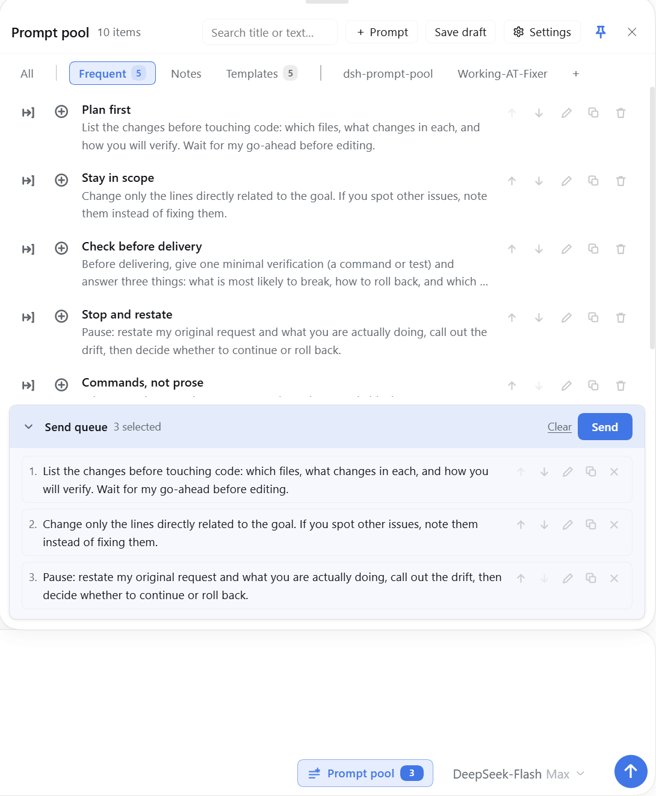

# Prompt pool · 提示池

[](https://www.npmjs.com/package/dsh-prompt-pool) [](https://dshfind.com/en/plugins/Ganttfly/dsh-prompt-pool?ref=badge)

A staging pool for prompts inside DeepSeek Harness: park a draft without sending it, arrange a playlist
of prompt items, and release the batch into the composer's send queue in order.



- Composer trigger beside the send controls (accent + count while something is queued)
- Starter prompts and templates follow the host language, and untouched built-ins switch with it
- Composer panel with search, group tabs, row actions and a send-queue card
- Right-click on selected conversation text to copy it or save it into a group (the last destination leads the menu)
- Full-height page in the right sidebar (native tab on DSH 0.2+, `dsh-better-sidebar` fallback)
- Groups: built-in, custom and one tab per workspace; each can be expanded, folded or hidden
- Settings for group order/display, visible workspaces and post-use retention
- A release shows progress and can be stopped; the unsent queue stays
- Confirmations for destructive actions, with undo on deletes and clears

Requires DSH >= 0.2.0-rc.1 (verified on 0.2.2-rc.1). This is a **bundle**: install the package, then
enable it in Settings → Plugins.

```powershell
dsh plugin add dsh-prompt-pool --profile <profile>
```

Full documentation: <https://github.com/Ganttfly/dsh-prompt-pool#readme> ·
[中文说明](https://github.com/Ganttfly/dsh-prompt-pool/blob/main/README.zh.md)

## Known limitations

- Non-image attachments are not captured (the toast reports how many were left behind).
- Reference chips (`@file`, `@session`) are stored and re-inserted as text, not clickable chips.
- A capture copies; it does not clear the composer.

MIT
